---
tags:
  - sdlc
  - product
  - prd
status: draft for review
created: 2026-10-22
related: "[[context-editor-design]]"
---

# Project Context Editor: Product Requirements Document

| Field | Value |
| --- | --- |
| Product | Project Context Editor (working name), an editor for every project document on the Neio SDLC V2 platform |
| Document status | Draft v0.1 for review. Describes a **built and tested prototype** plus what is still needed to ship it inside Neio |
| Date | 2026-10-22 |
| Product Owner / Architect / Engineering / QA Owner | To be named. Neio's spec header requires named people and approvers; none are invented here |
| Approver and date | Pending |
| Proposed risk tier | **3** (tenant data, role-gated draft visibility, a third-party AI call, untrusted file uploads) |
| Prototype status | Standalone application, 295 automated tests passing (217 service-level, 78 in a real browser) plus 9 JavaScript unit tests |
| Related documents | [Design document](context-editor-design.md), [README](../README.md), Neio `docs/architecture/erd.md` and `hld.md` |

**Reading guide.** Sections 1 to 6 say what the product is and must do. Section 7 describes how it is built. Section 8 says
how it fits the Neio SDLC V2 ERD and what must change on both sides. Section 9 lists what is deliberately not included.
Section 12 lists links, and says plainly which ones do not exist yet. Requirement status is marked **Built**, **Partial** or
**Not built**, so nothing here promises more than the prototype does.

---

## 1. Problem and goal

### 1.1 Problem

The Neio platform exists to keep "a reviewable chain from intent through architecture, delivery evidence, approval, and
release" (HLD goal 2) and to centralize project context. Its ERD already models governed artifacts, versions, approvals and
audit, but **there is nowhere for a person to write, revise, discuss or hand over those documents**:

- Project context (PRD, architecture notes, specifications, test strategy) lives in Word files, wikis and chat threads. It
  has no single owner, no single current version, and no record of who changed what.
- Teams cannot tell **which version is the official one**. Drafts leak to people who should only see approved content, or
  approved content is hidden because the author is still revising.
- Review feedback arrives as scattered emails and chat messages that are not tied to the text they refer to, and the author
  has to re-key each point into the document by hand.
- Existing documents cannot be brought in without being retyped, so adopting a new tool means starting over.
- The platform's Product Owner agent needs a governed place to read and propose changes to documents; today there is none,
  and an agent must never publish by itself.

There is no usage data or ticket history behind these statements yet: they come from the platform's own HLD, from the team's
description of the work, and from building the prototype. Gathering baseline numbers is open item Q-1 in section 10.

### 1.2 Goal

One place where **all project context is created, edited, reviewed, commented on, versioned, published and exported**, with
draft/published visibility enforced on the server, review feedback anchored to the exact text, and an AI assistant that
proposes changes the Product Owner accepts or rejects. It integrates with Neio's existing tenant, project, role-action
and audit model instead of introducing a parallel one.

### 1.3 Success measures

These are **proposed** targets. No baseline has been measured, because the problem is currently handled outside any tool.

| Measure | Baseline | Proposed target |
| --- | --- | --- |
| Draft content reaching a user without `doc.read_draft` (any endpoint, any export) | Not measurable today | **0**, enforced by automated tests on every release |
| Share of project documents authored or imported in the editor, per active project | Unmeasured | 80% within a quarter of rollout |
| Time from a team comment to the owner resolving it | Unmeasured | Median under 2 working days |
| Time to bring an existing document into the editor and publish it | Unmeasured | Under 15 minutes for a document up to 20 pages |
| Export success rate (PDF and Word) | n/a | 99% of attempts, with a clear message on failure |
| Share of assistant proposals the owner accepts in whole or in part | n/a | Tracked, no target (a learning metric) |

---

## 2. Users and roles

Roles are **tenant-defined groups of platform actions** (ERD: `roles`, `role_actions`). No code path tests a role name;
every decision asks "does this person hold action X on this project?". The demo seeds five roles to show the model.

| Role (demo name) | Typical person | Needs | Holds these actions | Must not be able to |
| --- | --- | --- | --- | --- |
| Product Owner | Owns the project's documents | Write, revise, import, publish, restore, export drafts, resolve feedback, use the assistant | all eleven (see 7.5) | Publish by way of the assistant |
| Executive | Sponsor, reviewer | Read the approved version, comment, export it | `doc.read`, `doc.comment`, `doc.export` | See a draft, edit, publish |
| Developer | Builds the system | Same as Executive | same | Same |
| Architect | Designs the system | Same, plus feedback on architecture text | same | Same |
| QA | Tests the system | Same, plus feedback on requirements | same | Same |
| Unassigned user | In the tenant, not on the project | Nothing | none | Learn that the project's documents exist |
| User of another tenant | Outside | Nothing | none | Read, write or learn that anything exists |

A tenant may add roles or change which actions a role holds without any change to the product. The one structural rule is
that **draft visibility is its own action** (`doc.read_draft`): whoever holds it can see unpublished versions, so tenants
can decide whether that is one person or a small group.

**Personas used in the demo:** Priya Nair (Product Owner), Erin Walsh (Executive), Dmitri Volkov (Developer), Arjun Mehta
(Architect), Sana Okafor (QA), Una Unassigned, and Gwen Park (Product Owner of a second tenant, used to prove isolation).

---

## 3. Product principles

1. **The server decides.** The read-only editor in the browser is a convenience. Every read and write is authorized on the
   server by action, tenant and project.
2. **Published is a promise.** Once published, a version never changes. The team always sees the latest published version
   and nothing newer, however much the owner is still drafting.
3. **History is never rewritten.** Versions, publications and audit events are insert-only. Deleting a comment hides it; it
   does not erase the record.
4. **The AI proposes, a person decides.** The assistant can only produce a draft the owner reviews change by change. It has
   no code path to publish.
5. **Uploaded content is hostile until proven otherwise.** Files, pasted HTML and model output all pass through one
   allowlist sanitizer before they are stored, shown, compared or exported.
6. **What you see is what you export.** Diagrams, charts and typography use one renderer and one stylesheet in the editor,
   the read-only view, the diff view and the PDF.
7. **Calm and minimal.** A centered reading column, one accent colour, no clutter, comparable in feel to Notion or Google
   Docs, not a default component-library page.

---

## 4. Features and requirements

Priority: **Must** (release fails without it), **Should** (important, has a workaround), **Could** (nice to have).
Status: **Built** (in the prototype and tested), **Partial**, **Not built**.

### 4.1 Authoring

| ID | Requirement | Priority | Status |
| --- | --- | --- | --- |
| R-1 | A user holding `doc.edit` can write and format text with: bold, italic, underline, strikethrough, subscript, superscript, inline code; headings H1 to H4; paragraph, block quote, horizontal rule | Must | Built |
| R-2 | Bulleted, numbered and checklist lists, with indent and outdent; checklist items can be ticked | Must | Built |
| R-3 | Hyperlinks can be added, edited, removed and opened in a new tab; only `http`, `https` and `mailto` targets are accepted | Must | Built |
| R-4 | Text alignment (left, centre, right, justify), text colour and highlight | Must | Built |
| R-5 | Tables: insert, add or delete rows and columns, header row toggle, merge and split cells, delete table | Must | Built |
| R-6 | Code blocks with syntax highlighting | Must | Built |
| R-7 | Undo and redo, clear formatting | Must | Built |
| R-8 | Word and Google Docs style shortcuts (for example Ctrl/Cmd+B, I, U, K, S, Z) | Must | Built |
| R-9 | A fixed toolbar, a floating toolbar on text selection, and a `/` menu that inserts blocks (14 items) | Must | Built |
| R-10 | The editor can be switched between editable and read-only at run time | Must | Built |
| R-11 | A save is explicit (button or Ctrl/Cmd+S); an indicator shows unsaved changes; closing the page with unsaved work asks first | Must | Built |
| R-12 | Images are not supported | n/a | By design (see section 9) |

### 4.2 Diagrams and charts

| ID | Requirement | Priority | Status |
| --- | --- | --- | --- |
| R-13 | A Mermaid diagram block renders live inside the editor, not only as code | Must | Built |
| R-14 | Clicking a diagram opens a split view: Mermaid code on one side, live preview on the other, with syntax errors shown inline and the last valid preview kept visible | Must | Built |
| R-15 | A chart block (bar, line, pie, area) renders in the editor; its data is edited in a small table dialog and stored as JSON in the block | Must | Built |
| R-16 | Diagrams and charts look the same in the editor, the read-only view, the diff view and both exports | Must | Built |
| R-17 | A diagram with invalid syntax shows an error card and never crashes the page or an export | Must | Built |

### 4.3 Document metadata

| ID | Requirement | Priority | Status |
| --- | --- | --- | --- |
| R-18 | Every document shows a non-editable header generated by the system: title, type, version, status (Draft or Published), created date and person, last edited date and person, last published date and person | Must | Built |
| R-19 | Metadata is never typed by hand and is not stored inside the document body; it is included in every export | Must | Built |
| R-20 | Timestamps are stored in UTC and shown in the viewer's local time (exports use the exporting viewer's time zone) | Must | Built |

### 4.4 Versions, drafts and publishing

| ID | Requirement | Priority | Status |
| --- | --- | --- | --- |
| R-21 | Every saved change creates a new version with an automatically incremented number; saving with no change creates nothing | Must | Built |
| R-22 | A version history lists each version with author, time, source (manual, assistant, restore) and published badge | Must | Built |
| R-23 | Any version the viewer may see can be opened read-only; two versions can be compared with additions and removals marked | Must | Built |
| R-24 | An older version can be restored; it becomes a new draft version and nothing is deleted | Must | Built |
| R-25 | A user holding `doc.read_draft` sees drafts, including version 1. A document with no published version is invisible to everyone else, including in lists, exports and comments | Must | Built |
| R-26 | A user holding `doc.publish` can publish the current draft with a confirmation dialog and an optional change note; after that the team sees only the latest published version while the owner keeps drafting | Must | Built |
| R-27 | Drafts are filtered out on the server for every read path, not only hidden in the page; a non-owner asking for a draft is refused | Must | Built |
| R-28 | Optimistic locking: a save or publish is rejected if the document changed since it was loaded, with a clear "document changed, reload" message that keeps the user's text | Must | Built |
| R-29 | Unsaved edits are kept while the owner looks at another version (for example "what the team sees") and return when they come back; if the document moved on meanwhile, saving is refused instead of overwriting | Must | Built |
| R-30 | The owner can switch to a read-only view of exactly what the team sees | Should | Built |
| R-31 | A document can be renamed; the rename is a saved version | Should | Built |

### 4.5 Comments and annotations

| ID | Requirement | Priority | Status |
| --- | --- | --- | --- |
| R-32 | A user holding `doc.comment` selects text in the version they are viewing and attaches a comment; the text is highlighted and clicking the highlight opens the thread. Selecting text never changes the document | Must | Built |
| R-33 | Document-level "general" comments for feedback not tied to text | Must | Built |
| R-34 | Each comment shows author, role badge (as it was when written), created time, edited time if edited, open or resolved status, and the document version it was made on | Must | Built |
| R-35 | One level of threaded replies; a reply is visible to everyone who can see its thread | Must | Built |
| R-36 | Authors edit or delete their own comments; deleting hides the comment but keeps the record | Must | Built |
| R-37 | A user holding `comment.resolve` resolves and reopens any thread | Must | Built |
| R-38 | Filters: all, open, resolved; the panel shows an open count | Must | Built |
| R-39 | If the annotated text is gone from the version being viewed, the comment is kept and marked "text no longer present" | Must | Built |
| R-40 | Comments made on an unpublished draft are invisible to people who cannot read drafts | Must | Built |

### 4.6 AI editing assistant

| ID | Requirement | Priority | Status |
| --- | --- | --- | --- |
| R-41 | A chat-style panel, available only to a user holding `agent.use` and `doc.edit`, accepts plain-language requests ("Add a risks table for vendor lock-in", "Rewrite section 3 more concisely", "Add a sequence diagram for login") | Must | Built |
| R-42 | The owner can include selected open comments in the request so the assistant incorporates them | Must | Built |
| R-43 | The assistant's output is shown as a visual diff (additions and removals); the owner accepts or rejects all changes or each change; accepted changes are saved as a new draft version marked as coming from the assistant | Must | Built |
| R-44 | The assistant can never publish. The only write it can cause is a draft save the owner triggers | Must | Built |
| R-45 | The model is called through OpenRouter's OpenAI-compatible API, entirely on the server; the key is read only from `OPENROUTER_API_KEY` and the model from `OPENROUTER_MODEL`; the key is never logged, stored or sent to the browser | Must | Built |
| R-46 | The assistant keeps existing diagrams and charts unless asked to change them, and produces valid Mermaid when it creates one; an invalid diagram in a proposal cannot be accepted | Must | Built |
| R-47 | Failures (timeout, rate limit, empty or invalid output) show a friendly message and never change the document; one request per document at a time; a per-user rate limit applies; the request can be cancelled | Must | Built |
| R-48 | Model output is sanitized before it is shown or saved | Must | Built |

### 4.7 Import (upload existing files)

| ID | Requirement | Priority | Status |
| --- | --- | --- | --- |
| R-49 | A user holding `doc.create` can upload an existing file; it is converted on the server and opens as a **new draft, fully editable**, with title and type adjustable first | Must | Built |
| R-50 | Supported: Word (.docx), PowerPoint (.pptx), Excel (.xlsx), PDF with a text layer, Markdown, HTML, CSV, plain text; up to 10 MB | Must | Built |
| R-51 | Files are checked by extension and by real signature; Office files by an archive guard and a refusal of XML entity tricks; all output is sanitized | Must | Built |
| R-52 | The user is told what was lost: images skipped, tables cut at 500 rows by 50 columns, hidden sheets, formulas (values only), PDF tables imported as text | Must | Built |
| R-53 | Old formats (.doc, .xls, .ppt, .rtf), scanned PDFs, empty, oversized, damaged or mislabelled files are refused with a specific message and create nothing | Must | Built |
| R-54 | Markdown extras are honoured: a `mermaid` fence becomes a diagram, `- [x]` items become a checklist | Should | Built |

### 4.8 Export

| ID | Requirement | Priority | Status |
| --- | --- | --- | --- |
| R-55 | Every document downloads as Word (.docx) and PDF, including the metadata header, formatting, tables, links, diagrams and charts | Must | Built |
| R-56 | PDF is rendered from print-styled HTML with the same typography as the screen, page numbers ("Page x of y") and the title in the header | Must | Built |
| R-57 | Word output uses real headings, lists and tables (not a picture of the page), so it stays editable in Word | Must | Built (checked structurally; not yet opened in Word itself) |
| R-58 | The team exports only published versions. A user holding `doc.export_draft` can also export the current draft, clearly marked DRAFT (banner, header, file name) | Must | Built |
| R-59 | Every export is recorded in the audit trail | Must | Built |
| R-60 | If the export browser is not installed the user is told how to fix it; nothing else is affected | Should | Built |

### 4.9 Access, security and experience

| ID | Requirement | Priority | Status |
| --- | --- | --- | --- |
| R-61 | Permissions resolve through the role-action mapping; role names appear nowhere in logic or UI | Must | Built |
| R-62 | Users reach only documents in projects they are assigned to, in their own tenant; anything else answers "not found" | Must | Built |
| R-63 | Layout: project documents with status badges on the left, the editor in the centre, comments, history and the assistant on the right (toggleable) | Must | Built |
| R-64 | Interface font Inter, document font Source Serif 4, code font JetBrains Mono, all self-hosted (nothing loads from a third party at run time) | Must | Built |
| R-65 | Light and dark themes (remembered), skeleton loading states, toasts for save, publish and export, clear empty states | Must | Built |
| R-66 | Usable down to tablet width with no horizontal scrolling; side panels collapse into drawers | Must | Built |
| R-67 | Grouped actions are icon buttons with an accessible name and a tooltip | Should | Built |
| R-68 | Real sign-in (SSO) and tenant lifecycle checks (suspended tenant, disabled user) | Must (for Neio) | **Not built**; supplied by Neio (section 8.2) |
| R-69 | Structured logs with correlation and tenant identifiers | Must (for Neio) | **Not built** (section 8.6) |

### 4.10 Business rules

- **BR-1:** Only the latest published version is visible to people without `doc.read_draft`. Earlier published versions are
  not shown to them, so their version numbers can skip (for example 2 then 5).
- **BR-2:** Publishing requires that the version being published is the current draft; a stale publish is refused. A version
  can be published once.
- **BR-3:** Versions and publications are never updated or deleted; a restore copies content into a new version.
- **BR-4:** A comment keeps the version it was written on and the role it was written under, even if roles change later.
- **BR-5:** A deleted comment is hidden but kept. A deleted comment with replies shows as a placeholder so the thread
  still makes sense; one without replies disappears from view.
- **BR-6:** Audit events record who did what to which item and when, with identifiers and counts only. They never contain
  document text, comment text, prompts or file contents.
- **BR-7:** The assistant acts on the draft the owner had open. If the draft changed before the owner applies the result,
  the result is refused.

### 4.11 Operation behaviour (wait or background)

Everything is a **wait** operation today; there are no background jobs. Times are informal measurements on a developer
laptop, not load-tested (see O-5).

| ID | Operation | Typical / longest | While it runs | If it fails |
| --- | --- | --- | --- | --- |
| OP-1 | Open a document | under 1 s / 3 s | Skeleton, then content | Error toast, previous view kept |
| OP-2 | Save, publish, restore | under 1 s / 3 s | Button spinner, disabled | Message; stale save keeps the user's text and offers reload or copy |
| OP-3 | Import a file | 1 to 3 s small files; longer for large PDFs / 10 MB limit | Spinner in the dialog | Specific message; nothing created |
| OP-4 | Export PDF or Word | 2 to 4 s / 30 s hard limit | Button spinner, toast | "Could not be created, try again"; nothing downloaded |
| OP-5 | Assistant request | model dependent / 60 s per attempt, up to 3 retries with backoff | "Working" status, cancel button | Friendly message; document untouched |
| OP-6 | Mermaid or chart render | under 1 s / 3 s | Skeleton or last preview | Error card |

---

## 5. User flows

**Author and publish.** The owner creates or imports a document, edits it (each save is a version), checks "what the team
sees", then publishes with an optional note. The team now sees that version; the owner's next edit is a new draft the team
cannot see.

**Review and incorporate.** A team member selects text in the published version and comments. The owner sees the highlight,
replies or resolves, or selects open comments and asks the assistant to fold them in. The assistant proposes a diff; the
owner accepts all, some or none; accepted changes become a new draft.

**Bring in an existing document.** The owner uploads a file, sees what was imported and what was skipped, adjusts the title
and type, and opens it in the editor as a draft with every formatting tool available.

**Hand over.** Any team member exports the published version as PDF or Word. The owner can export the draft; it is marked
DRAFT everywhere.

---

## 6. Experience and design

Screenshots below are taken from the working prototype (they are not design mocks; see section 12).

| | |
| --- | --- |
| 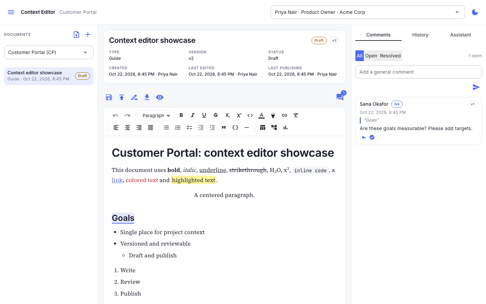 **Owner workspace:** documents, metadata block, toolbar, editor, comments panel | 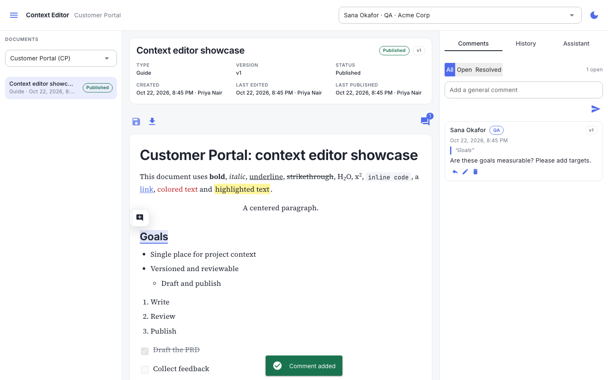 **Team view:** read-only published version, anchored comment with role badge |
| 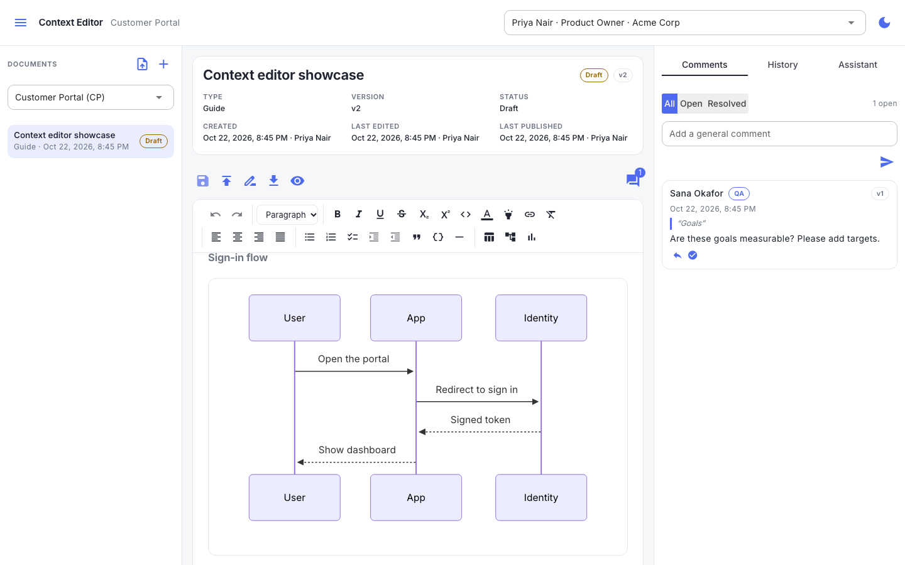 **Diagrams and charts** rendered in the document | 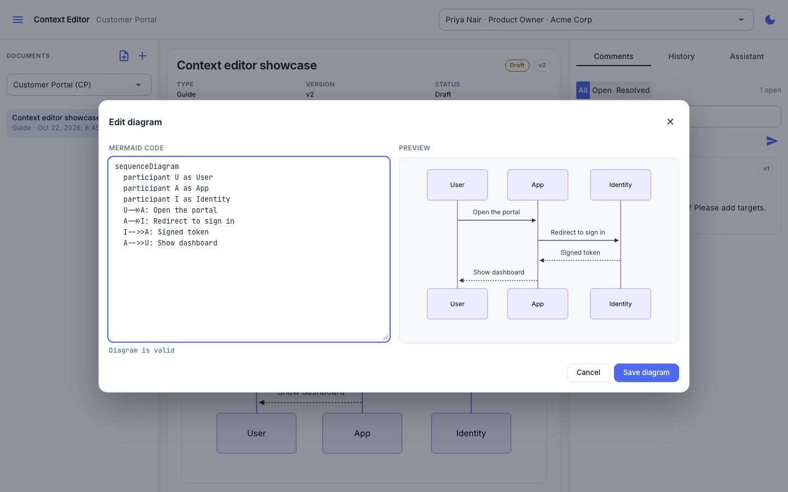 **Diagram editor:** code left, live preview right, inline errors |
| 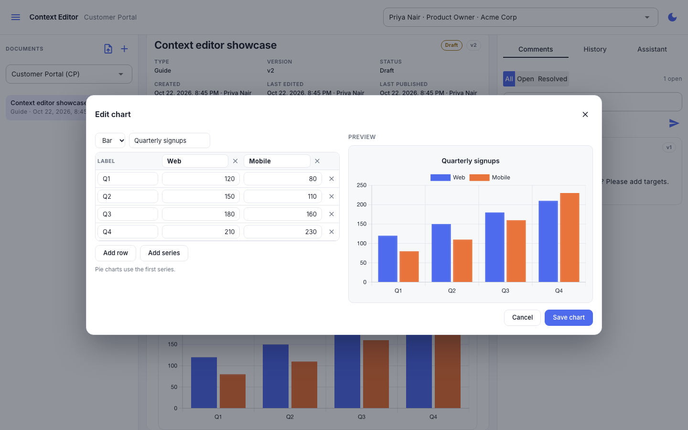 **Chart editor:** table of values, type, live preview | 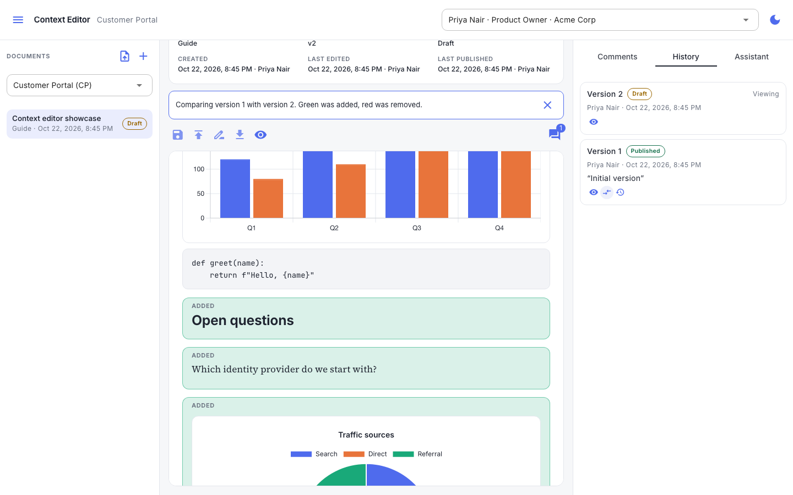 **Compare versions:** additions in green, removals in red |
| 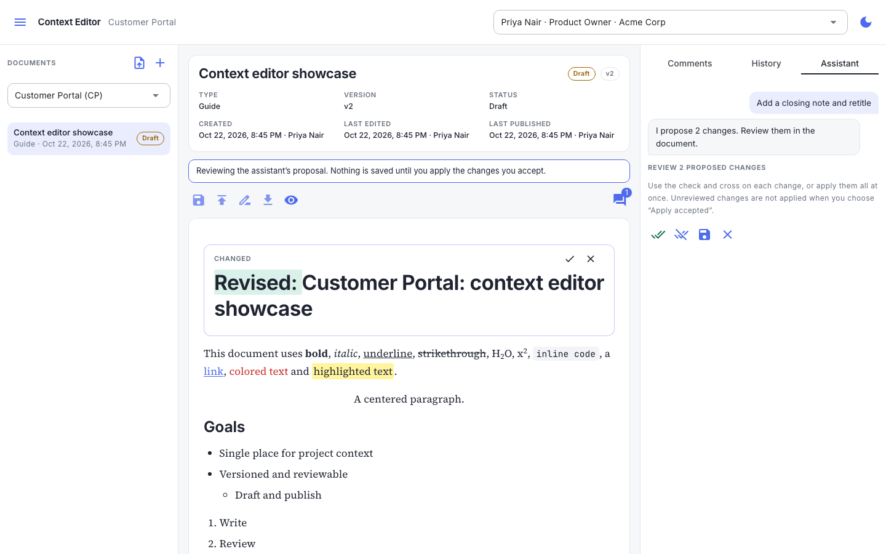 **Assistant proposal:** per-change accept or reject | 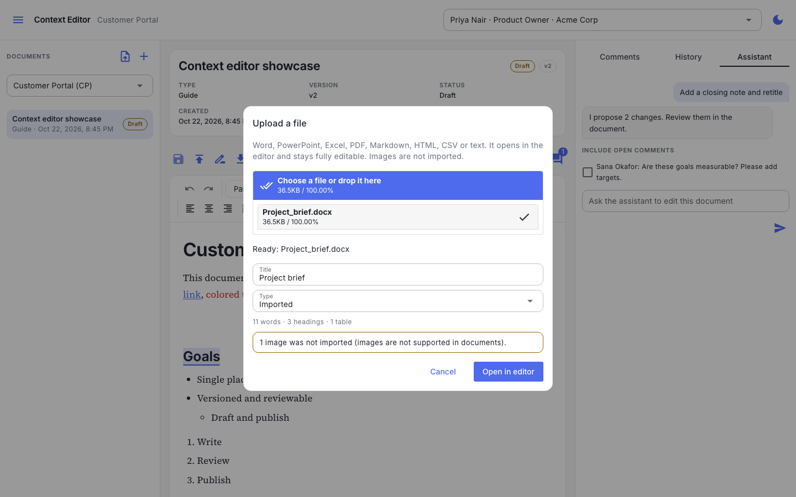 **Upload:** what was found, what was skipped, title and type |
| 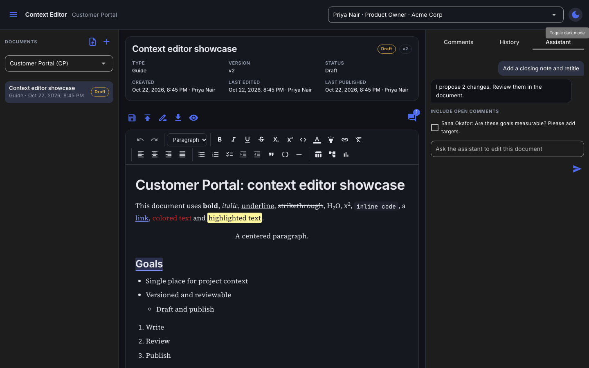 **Dark theme** | 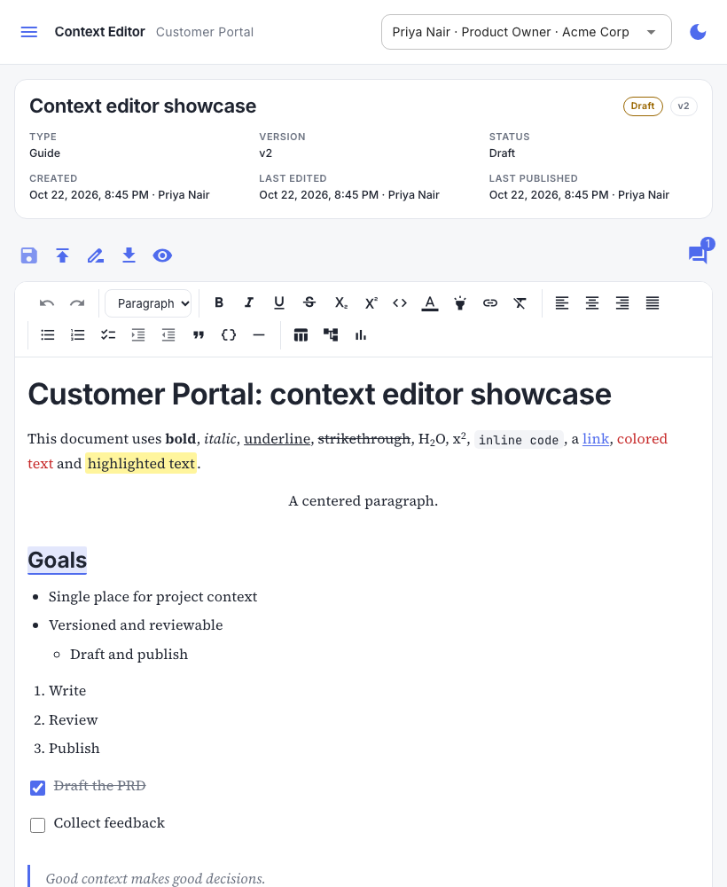 **Tablet width** |

Design decisions: a centered column about 760 px wide with generous line height; Source Serif 4 for reading, Inter for
the interface; a neutral palette with one accent; subtle hover states and transitions that respect reduced-motion; icon
buttons with tooltips for grouped actions; every interactive control reachable by keyboard.

---

## 7. Architecture

### 7.1 System context

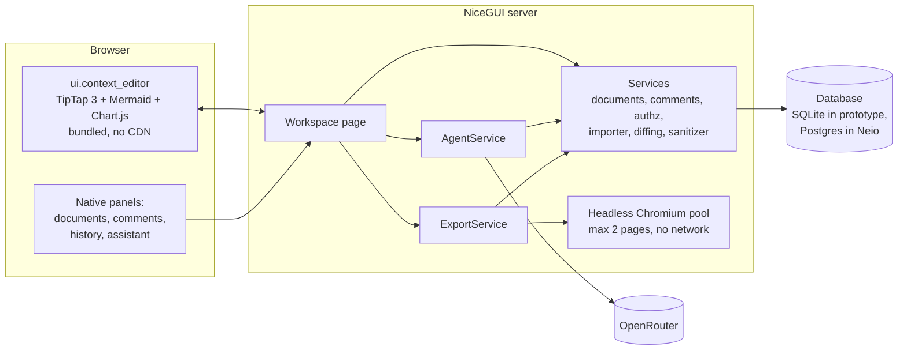

### 7.2 Technology

| Layer | Choice | Notes |
| --- | --- | --- |
| UI shell | Python 3.13, NiceGUI 3.18 | Matches Neio's stack |
| Editor | TipTap 3.32.0 (MIT) wrapped as `ui.context_editor`, bundled locally with npm and rollup | Exact versions pinned; no TipTap Pro or Cloud features; the built bundle is committed so the app runs without Node |
| Diagrams, charts | Mermaid 12.2.0 (`securityLevel: strict`), Chart.js 4.5.1 | Lazy-loaded chunks |
| Code highlighting | lowlight 3.3.0 | Common languages |
| Sanitizing | nh3 0.3.7 plus lxml block validators | One allowlist, run on write and on every read |
| Word export | python-docx 1.2.0, Pygments for code colours | Real Word structures |
| PDF export, diagram images | Playwright 1.64 with headless Chromium | Same stylesheet and renderer as the editor |
| Import | mammoth, markdown-it-py, openpyxl, python-pptx, pdfplumber, defusedxml | Converters run in a worker process |
| Assistant | OpenRouter via `httpx` | OpenAI-compatible; thin client behind a protocol so the provider can change |
| Storage (prototype) | SQLite, numbered SQL migrations with tested down scripts | Replaced by Neio's Postgres on integration (section 8) |
| Tests | pytest, Playwright, vitest | See 7.10 |

The prototype is about 5,200 lines of Python and 1,750 lines of JavaScript, excluding tests and the built bundle.

### 7.3 Layered enforcement

1. **Services (authoritative).** Every method resolves the caller's actions through the role-action matrix, derives the
   tenant from the caller's membership (never from the request), checks project assignment, and then acts. Writes run in
   one transaction together with their audit event.
2. **Input handling.** Validation, size limits and sanitizing happen before storage; the same sanitizer runs again on
   every way out (page, diff, export, assistant input), because a user holding a database token could otherwise write
   unsanitized content straight to the store.
3. **UI.** Reads the caller's action list only to show or hide controls. It is never the control.

Answers are deliberately uniform: another tenant's document, an unassigned project, and a document with no published
version (for someone who cannot read drafts) all answer "not found", so existence is not leaked. Asking for an explicit
unpublished version of a visible document answers "permission denied".

### 7.4 Data model

Names follow the Neio ERD (`tenant_id` is the implementation's name for `organization_id`). Timestamps are UTC.

| Table | Purpose | Key rules |
| --- | --- | --- |
| `tenants`, `users`, `projects` | Context needed to run standalone (`users` stands in for `user_profiles`) | In Neio these already exist or come from the RBAC feature |
| `roles`, `actions`, `role_actions`, `memberships`, `membership_roles` | The ERD's role-action matrix, with optional project scope | `actions` is a platform catalogue; roles belong to a tenant |
| `documents` | A logical document: title, free-text type, `current_version` (also the lock token), `published_version`, created, updated and published by/at | One row per document |
| `document_versions` | Immutable content: sanitized HTML, SHA-256 hash, source (`manual`, `agent`, `restore`), restored-from, assistant request, author, time | Unique `(document, version)`; update and delete refused by trigger |
| `document_publications` | One row per publish: version, change note, who, when | Unique per version; update and delete refused by trigger |
| `comments` | Text-anchored and general comments: quote, prefix, suffix, hint, parent, author, role code and label at write time, body, status, edited, deleted, resolved | One reply level and same tenant/project enforced by trigger |
| `agent_requests` | Each assistant request: prompt, comment ids, model, base version, status, sanitized proposal, accepted changes, resulting version, error class, correlation id, token counts, latency | Status: pending, proposed, accepted, partial, rejected, failed, stale |
| `audit_events` | Append-only history | Update and delete refused by trigger; identifiers, versions and hashes only |

There is deliberately **no status column on versions**. A version is "published" when a publication row exists for it, so
published content can never be edited by a status flip.

### 7.5 Permissions

Action codes (ERD style, all project scope):

| Code | Meaning |
| --- | --- |
| `doc.read` | Read the latest published version |
| `doc.read_draft` | Read unpublished versions and the full history |
| `doc.create` | Create documents and import files |
| `doc.edit` | Save draft versions |
| `doc.publish` | Publish a version |
| `doc.restore` | Restore an older version as a new draft |
| `doc.export` | Export published versions |
| `doc.export_draft` | Export the current draft |
| `doc.comment` | Comment, reply, edit and delete own comments |
| `comment.resolve` | Resolve and reopen any comment |
| `agent.use` | Use the assistant |

An organization-wide role assignment contributes only actions whose scope is organization or any; a project assignment
contributes project or any (the ERD's scope rule). The demo seeds Product Owner with all eleven and every other role with
`doc.read`, `doc.comment`, `doc.export`.

### 7.6 Storage format and the sanitizer contract

Documents are stored as **sanitized HTML**. Custom blocks:

```html
<div data-type="mermaid">diagram source as text</div>
<div data-type="chart" data-chart='{"type":"bar","title":"","labels":[],"series":[{"name":"","values":[]}]}'></div>
<ul data-type="taskList"><li data-type="taskItem" data-checked="true"><div>…</div></li></ul>
```

The sanitizer allows a fixed tag set, only `color`, `background-color` and `text-align` styles (stored in the form
browsers produce), only `http`, `https` and `mailto` links (always opened in a new tab with `noopener noreferrer`), and
validates every block: a document is at most 1,000,000 characters; a diagram at most 20,000; a chart is one of four types
with at most 12 series and 200 labels and numeric values only. An invalid chart **fails the save**; it is never silently
repaired. A browser test loads a document using every node and mark into the real editor and proves the editor emits
exactly what the sanitizer allows, so the two cannot drift apart.

Chart numbers are written without a trailing `.0` so the editor and the server produce identical text.

### 7.7 Versioning and publishing

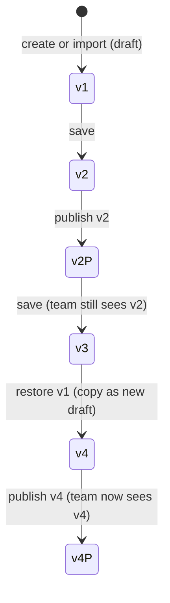

A save updates `current_version` only if it still equals the version the user loaded (otherwise `StaleVersion`), inserts
the new version row and writes the audit event, all in one transaction. A publish inserts a publication row and moves
`published_version`; it never creates content.

### 7.8 Comments

A comment's anchor is a **text-quote selector** (the quoted text plus up to 64 characters of context on each side and a
position hint) stored with the comment. The editor finds it again in whatever version is shown and draws the highlight as a
decoration, so a published version is never touched when someone comments. The same resolver tells the panel which anchors
no longer match, which is what produces "text no longer present". The resolver has JavaScript unit tests.

### 7.9 Assistant, import and export pipelines

**Assistant.** Check actions (`agent.use` and `doc.edit`), rate limit (10 per minute per user) and one request per
document; replace each diagram and chart with a placeholder so they are preserved and not sent; mask secret-looking
strings; send the document, the instruction and any selected comments as clearly delimited data (never instructions) to the
model (60 s timeout, up to 3 retries with backoff, input up to 400,000 characters, instruction up to 4,000); sanitize the
reply, restore the placeholders, compute a block diff; the owner accepts or rejects change by change; accepted changes are
saved against the version the request started from, or refused as stale. A dropped placeholder shows up as a removal the
owner can reject.

**Import.** Decide type by extension and verify the signature; guard Office archives (at most 3,000 entries, 150 MB
unpacked, a compression-ratio check, every XML part parsed with entity expansion refused); convert in a worker process;
normalise to the editor's schema (headings deeper than 4 become 4, images removed and counted); sanitize; refuse empty
results. Output over the document size limit is refused, not truncated.

**Export.** Authorize and audit through the same call that returns the content (published needs `doc.export`, a draft needs
`doc.export_draft`); build a print page from the sanitized HTML with the metadata block; open it in headless Chromium that
can reach only the local page, the editor's rendering bundle and the fonts; wait for diagrams and charts to render; print
to PDF (A4, 20 mm side margins, header and footer templates), or screenshot each diagram and chart and place the pictures in
a Word file built from real structures. At most two pages render at once with a 30-second limit.

### 7.10 Quality and tests

| Layer | What it proves | Count |
| --- | --- | --- |
| Services | Roles, tenants, drafts, versions, locking, audit, comments, diff, sanitizer, import, agent, DOCX | 217 |
| Browser (real Chromium against the real app) | Every formatting feature, save and reload, round-trip contract, stale save, publish flow, comments, history, diagrams, charts, export, assistant, upload, kept edits, dark mode, tablet width, no third-party requests | 78 |
| JavaScript unit tests | Comment anchor resolution | 9 |

Browser tests skip, rather than fail, when Chromium is not installed. A fresh clone was verified to install and run with
`uv sync` and `uv run context-editor`.

### 7.11 Limits

| Item | Limit |
| --- | --- |
| Document size | 1,000,000 characters |
| Diagram source | 20,000 characters |
| Chart | 4 types, 12 series, 200 labels, numeric values |
| Title, document type, change note | 200, 60, 1,000 characters |
| Comment, quoted text | 5,000, 2,000 characters |
| Upload | 10 MB; tables 500 rows by 50 columns; 20 sheets; 300 slides; 200 PDF pages |
| Assistant instruction, document sent | 4,000, 400,000 characters |
| Export | 2 concurrent pages, 30 s each |

### 7.12 Configuration and deployment

| Variable | Purpose |
| --- | --- |
| `OPENROUTER_API_KEY` | Enables the assistant; read only from the environment; never logged or sent to the browser |
| `OPENROUTER_MODEL` | Model identifier (default `anthropic/claude-sonnet-4.5`) |
| `CONTEXT_EDITOR_DB`, `PORT`, `NICEGUI_STORAGE_SECRET` | Prototype database file, port and session secret |

Deployment needs Chromium and its system libraries for export (`playwright install --with-deps chromium`, roughly 400 MB
in a container image). Node is needed only to rebuild the editor bundle.

---

## 8. Integration with the Neio SDLC V2 ERD

The prototype was built to the ERD's shape on purpose. This section is the plan for moving it onto the platform.

### 8.1 Where each part fits

| Neio ERD entity | Editor table | Fit | What changes |
| --- | --- | --- | --- |
| `organizations` (implemented as `tenants`) | `tenants` | Same | Use Neio's table; add tenant status gating (R-68) |
| `user_profiles` | `users` | Same shape | Use Neio's |
| `memberships`, `roles`, `actions`, `role_actions`, `membership_roles`, `projects` | Same names | Same | **Not yet built in Neio's migrations as of the repository snapshot read on 2026-10-22** (only the interim `tenant_users` exists), so this is a dependency, not a rewrite |
| `artifacts` | `documents` | Close | Map `doc_type` to `artifact_type`; add `classification`, `retention_policy_id`, optional `work_item_id`; optionally a nullable `artifact_id` link |
| `artifact_versions` | `document_versions` | Close, with one real gap | ERD requires `blob_uri`, `blob_version_id`, `content_hash`; the editor has the hash and stores HTML in the database (7.4). `authored_by` and `author_kind` map to `created_by` and `source` (`agent` is agent, the rest human) |
| (none) | `document_publications` | New | Insert-only publish record with change note |
| `approval_requests`, `approval_subjects`, `approval_decisions` | (none) | Natural next link | A publish can become the Product Owner approval gate bound to the exact `artifact_version` (see 8.4) |
| `agent_runs` | `agent_requests` | Overlap | `agent_requests` holds editing detail (prompt, base version, proposal, accepted changes); link it 1:1 to an `agent_runs` row with `agent_type = product_owner` |
| `audit_events` (implemented as `tenant_audit_events`) | `audit_events` | Same intent | Write the editor's events into Neio's table with `project_id` in the payload |
| `retention_policies`, `audit_holds` | (none) | Inherited | Holds and retention follow the artifact; comments need a classification decision (O-6) |
| `prior_art_sources` | (none) | Optional | An import could register an `uploaded/document` source with its hash; the original file is not kept today |

### 8.2 What the editor needs from Neio

1. **The RBAC tables and project scope** (roles, actions, role-action grants, membership roles with a nullable project).
   Until then Neio's `tenant_users.role` (`tenant_admin`, `tenant_user`) cannot express "Product Owner of this project".
2. **Tenant sign-in** (feature F-02). Today only a seeded demo can open the editor.
3. **Tenant and user lifecycle checks** (suspended tenant, disabled user) on every call.
4. **Storage decision** between keeping HTML in Postgres with a content hash, or writing bodies to Azure Blob (feature F-07
   is still at spec drafting). The HLD says artifact bodies live in Blob; this PRD recommends Postgres first because it
   unblocks the editor and keeps per-version reads simple, with a path to Blob (7.4, 8.3).

### 8.3 Proposed ERD amendments (for approval through Neio's process)

1. `documents` added, optionally referencing `artifacts`, **or** `artifacts` extended with `title`, `current_version`,
   `published_version`; either way the editor's lock token and publish pointer need a home.
2. `artifact_versions` allowed to hold inline content (`content_html`) with `content_hash` until Blob is available;
   `blob_uri` and `blob_version_id` become nullable for that artifact type. This relaxes ERD rule 4 ("mandatory before
   eligible for approval") for editor documents, so it needs an explicit decision.
3. `document_publications` added (insert-only).
4. `comments` added (tenant-owned free text; one reply level; soft delete; anchor selector fields).
5. `agent_requests` added and linked to `agent_runs`.
6. Eleven action codes added to the platform catalogue (7.5), all project scope.

### 8.4 Mapping the operations onto Neio's RPC pattern

Neio performs writes through `security definer` functions that derive the tenant from `auth.uid()`, check authorization,
and write the change plus an audit row in one transaction, with fixed SQLSTATEs (`42501` access denied, `P0002` not found,
`55000` state conflict such as a stale save, `23514` validation). The services map one-to-one:

| Editor operation | Proposed function | Notes |
| --- | --- | --- |
| list, read, versions, capabilities | `doc_list`, `doc_get`, `doc_versions`, `doc_capabilities` | Draft filtering lives here |
| create, import | `doc_create` | Content sanitized by the app before the call and again on read |
| save, restore | `doc_save_draft`, `doc_restore` | Compare-and-set on `current_version`; stale answers `55000` |
| publish | `doc_publish` | Today a direct publication row; later it can open and satisfy an `approval_request` |
| export | `doc_export_payload` | Authorizes and audits in one call |
| comments | `comment_add`, `_edit`, `_delete`, `_resolve`, `_reopen`, list | Role badge written by the function from the caller's assignment |
| assistant | `agent_request_create`, `_set_proposal`, `_resolve` | `source = agent` additionally requires `agent.use` |

**Publish as an approval gate (recommended follow-up).** The HLD's workflow has a Product Owner approval step. Publishing
would create an `approval_request` whose `required_action_id` is `doc.publish`, bound by `approval_subjects` to the exact
`artifact_version`, so an approval can never apply to a later version. This also lets Neio enforce separation of duties
where policy requires a reviewer other than the author.

### 8.5 Sanitization across the trust boundary

Postgres cannot sanitize HTML, and a user holding a database token can call a save function directly. The editor therefore
sanitizes on the way in **and** on every way out. That rule must survive the move: keep the sanitizer in the read path
of the page, the diff, the export and the assistant.

### 8.6 Conformance with Neio's engineering invariants

| Neio rule (AGENTS.md and ERD) | Prototype | Gap |
| --- | --- | --- |
| Tenant scope and authorization on the server for every read and write | Met | Re-implement in functions (8.4) |
| No secrets or sensitive tenant data in prompts, logs, audit, browser payloads | Key never logged, stored or sent; audit holds identifiers only | Document text, comments and prompts **are** sent to a third party and the prompt is stored. ERD rule 8 asks for redaction and classification first. Only secret patterns are masked today (Q-3) |
| Append-only audit; correct with compensating events | Met (triggers) | Map to `tenant_audit_events` |
| Idempotent, correlated background work with bounded retries | No background work; the model call has bounded retries; requests carry a correlation id | Import has no time limit (O-5) |
| Backward-compatible migrations with a tested rollback | Met for the prototype | Port to Supabase with pgTAP tests |
| Structured observability with correlation and tenant identifiers | Minimal logging | **Gap (R-69):** adopt Neio's logging and telemetry context |
| Tests for allowed and denied access and state transitions | Met | Re-run against the functions |
| NiceGUI: no blocking on the event loop, busy states, icon buttons, go-back button in the shared page frame | Met except the frame | Use Neio's shared page frame and header (the editor has its own theme today) |
| Separation of duties for approvals | **Not enforced** (the same person can save and publish) | Resolve through the approval gate (8.4) |

### 8.7 Integration phases

| Phase | Scope | Exit |
| --- | --- | --- |
| I-0 | Decisions Q-2 to Q-5; ERD amendments approved | Amendments recorded |
| I-1 | RBAC tables and project scope in Neio (prerequisite feature) | Role-action matrix tests green |
| I-2 | Port schema and rules to Supabase functions; reuse the editor element unchanged; run the existing denied-access matrix against them | Same tests green on Postgres |
| I-3 | Neio page frame, sign-in, tenant lifecycle, logging and telemetry | Conformance table (8.6) closed |
| I-4 | Publish as an approval gate; optional Blob storage; prior-art registration | Approvals bind to exact versions |
| I-5 | Security review (tester, senior developer, security tester) and UAT | Review cycle closed |

The editor element (`ui.context_editor`), the sanitizer, the diff engine, the importer, the exporter and the assistant
client contain no database code and move across unchanged. The services are the part that is re-implemented.

### 8.8 Open questions for the Neio team

1. Storage: Postgres first with a path to Blob, or wait for F-07?
2. Which role or roles hold `doc.read_draft`, `doc.publish` and `agent.use` by default in a new tenant?
3. Is the assistant allowed to send tenant document text to a third-party model? What classification, redaction and
   data-handling setting (for example zero-retention providers) does the platform require?
4. Should publishing be an approval gate from day one?
5. How should comment text be classified and retained?

---

## 9. Out of scope

| Item | Why it is out | When it could return |
| --- | --- | --- |
| Real-time multi-user co-editing | Optimistic locking covers the single-owner model; co-editing needs a different architecture | If more than one person routinely edits the same draft |
| Images in documents | Explicitly excluded; also removes a large upload and sanitizing surface | On request, with an asset store |
| Agents raising flags on their own after a document is created | Parked; the assistant only responds to the owner | After the governance model for autonomous agents is set |
| Delivery timeline documents | Not yet defined | When defined |
| A catalogue of default document types and templates | The prototype takes a free-text type; the team chose an editor only | When the project baseline defines the standard documents |
| Real sign-in and tenant lifecycle | Supplied by Neio (F-02, F-01, F-03) | Integration phase I-3 |
| Azure Blob storage of bodies | Depends on F-07 | Integration phase I-4 |
| Approval workflow and separation of duties | Belongs to Neio's approval service | Integration phase I-4 |
| Tenant-level consent for the assistant and data classification | Deferred by decision; flagged as risk | Before any production use with real tenant data |
| Custom-role administration screens | Neio's RBAC feature | Neio roadmap |
| Notifications (email, in-app) for new comments or publishes | Not requested | After first user feedback |
| Importing into an existing document, merging uploads | Each upload creates a new draft | On request |
| Word round-trip fidelity beyond structure | Import drops text colour, alignment, fonts and images | On request |
| OCR for scanned PDFs; legacy .doc, .xls, .ppt, .rtf | Refused with a clear message | If demanded |
| Branching, merging and word-level partial acceptance of changes | The diff works on whole blocks | If whole-block review proves too coarse |
| Full-text search across documents | Not requested | Later |
| Offline editing; screens narrower than a tablet | Not requested | Later |
| Per-process limits becoming shared (assistant rate limit, in-flight guard) | Single-process prototype | When deployed with several workers |

---

## 10. Risks, assumptions and open decisions

### 10.1 Risks

| ID | Risk | Likelihood / impact | Mitigation |
| --- | --- | --- | --- |
| K-1 | Tenant text sent to a third-party model without agreed policy | High / High | Keep the assistant off until Q-3 is decided; add tenant consent and classification; mask secrets (partly done) |
| K-2 | Neio's RBAC tables do not exist, blocking integration | Certain / High | Schedule the RBAC feature first (8.2) |
| K-3 | Whole-block diff feels too coarse on long paragraphs | Medium / Medium | Review with real documents; the inline word marks already show what changed inside a block |
| K-4 | Word output looks different in real Word | Medium / Medium | Open sample exports in Word during UAT; Cambria and Calibri are used because Source Serif is rarely installed |
| K-5 | Headless Chromium adds image size and a process to supervise | Medium / Low | Concurrency cap and timeout exist; document in the deployment checklist |
| K-6 | Conversion of unusual files fails or loses structure | Medium / Low | Specific messages, a list of what was lost, owners can edit after import |
| K-7 | Demo persona switcher mistaken for authentication | Low / High | Marked in the README; replaced at integration phase I-3 |

### 10.2 Open questions

| ID | Question | Owner |
| --- | --- | --- |
| Q-1 | What baseline data exists for time-to-publish and feedback cycle time, so targets in 1.3 can be firm? | Product Owner |
| Q-2 | Storage: Postgres first or wait for Blob? | Architect |
| Q-3 | Policy for sending tenant text to the model; classification and redaction rules | Product Owner, security |
| Q-4 | Is publish an approval gate from day one, and does separation of duties apply? | Product Owner, Architect |
| Q-5 | Default holders of `doc.read_draft`, `doc.publish`, `agent.use` | Product Owner |
| O-5 | Add a time limit to imports and a load test for the stated times | Engineering |
| O-6 | Retention and classification for comments and assistant requests | Architect |

---

## 11. Acceptance criteria

Each criterion maps to automated tests (service tests in `tests/test_documents.py`, `test_comments.py`, `test_sanitizer.py`,
`test_diffing.py`, `test_importer.py`, `test_agent.py`, `test_export*.py`; browser tests in `test_e2e*.py`,
`test_editor_features.py`, `test_roundtrip.py`).

| ID | Req | Given | When | Then |
| --- | --- | --- | --- | --- |
| AC-1 | R-25, R-27 | A document with published v1 and draft v2 | A team member opens it or asks for v2 | They see v1 only; asking for v2 is refused |
| AC-2 | R-25 | A document with no published version | A team member lists, opens or exports it | It is absent from lists and answers "not found" everywhere |
| AC-3 | R-26 | v2 published, then the owner saves v3 | The team reloads | They see v2 and no trace of v3 |
| AC-4 | R-61 | A team member | They try to save, publish, restore or create | Each is refused |
| AC-5 | R-62 | A user of another tenant, and an unassigned user | They try to read, write, publish, list, comment or create | Every call answers "not found" |
| AC-6 | R-21, R-18 | The owner saves | Each save completes | The version number increases by one and the metadata shows the new editor and time |
| AC-7 | R-21 | A save with no change | The owner presses Save | No version is created |
| AC-8 | R-28 | Two tabs on the same version | Both save | The second is refused with "document changed, reload" and keeps its text |
| AC-9 | R-24 | Versions 1 to 2 | The owner restores v1 | v3 exists with v1's content; v1 and v2 remain |
| AC-10 | BR-3, BR-6 | Stored versions, publications and audit events | Anyone tries to update or delete them | The database refuses; audit rows hold no document text |
| AC-11 | R-1 to R-10 | The editor open | Each feature is used from the toolbar or a shortcut | The expected markup appears and toggles off again |
| AC-12 | R-1 to R-9, R-55 | A document using every feature | It is saved, reloaded and exported | Formatting survives all three |
| AC-13 | R-48, R-51 | Known script, handler, style and link attacks | They are stored or read | They are neutralised and the result is stable under a second pass |
| AC-14 | R-13, R-14, R-17 | A diagram | It is edited with valid then invalid code | The preview updates live, the error shows inline, the page does not crash |
| AC-15 | R-15 | A chart | Values, type and rows change; a non-number is entered | The chart redraws; saving with a non-number is refused |
| AC-16 | R-32, R-34 | A team member selects text in the published version | They post a comment | The text is highlighted; the card shows author, QA badge, time and v1; the document is unchanged |
| AC-17 | R-37 | An open comment | A team member and then the owner try to resolve it | Only the owner can; the owner can reopen it |
| AC-18 | R-39 | A comment on text the owner later edits away | The owner views the new draft | The comment is kept and marked "text no longer present" |
| AC-19 | R-35, R-36, R-40 | An owner reply written on the draft; a deleted comment | The team views the thread | The reply is visible; a deleted comment with replies shows a placeholder |
| AC-20 | R-43 | An assistant request | The proposal arrives | A diff appears and nothing is saved until the owner accepts |
| AC-21 | R-43 | A proposal with two changes | The owner accepts all, one, or none | A draft with the right content, a partial draft, or no change |
| AC-22 | R-44 | A team member | They try to use the assistant | It is refused; the assistant has no publish path |
| AC-23 | R-45 | A recognisable test key | Requests succeed and fail | The key is absent from responses, logs, stored rows and audit events |
| AC-24 | R-47 | The model times out, rate-limits or returns junk | The owner sends a request | A friendly message appears and the document is unchanged |
| AC-25 | R-55, R-56, R-58 | A published document | A team member exports PDF | Metadata, content, "Page 1 of n" and no DRAFT mark; no draft text |
| AC-26 | R-58 | A draft | The owner exports it; a team member tries | The owner's file is marked DRAFT; the team member is refused |
| AC-27 | R-57 | A document with headings, lists, tables, a diagram and a chart | Word export | Real heading and list styles, merged table cells, two pictures |
| AC-28 | R-59 | Any export | It completes | An audit event records the format and version |
| AC-29 | R-49, R-50 | Each supported file type | The owner uploads it | A new editable draft opens with the content |
| AC-30 | R-51, R-53 | Wrong type, mislabelled, scanned, oversized, bomb and entity-attack files | Uploaded | Each is refused with a specific message and nothing is created |
| AC-31 | R-49, R-61 | A team member | They look for upload | No upload control exists and the server refuses |
| AC-32 | R-29 | The owner with unsaved edits | They view what the team sees or an older version, then return | The edits are back; if the document changed meanwhile, saving is refused |
| AC-33 | R-64, R-65, R-66 | The app | It is loaded at desktop and tablet width, light and dark | No horizontal scrolling, fonts load locally, no third-party requests |
| AC-34 | R-60 | No export browser installed | The user exports | A message says how to install it; the rest of the app works (checked manually; the browser tests skip) |

---

## 12. Links

| Item | Link | Status |
| --- | --- | --- |
| **Repository** | `TBD` | **Not published.** The project is a local git repository with no commits and no remote. Add the GitHub URL here after the first push |
| **Live prototype** | `TBD` | **Does not exist.** Nothing is hosted. Run it locally: `uv sync`, `uv run context-editor`, then open `http://localhost:8080` (see the README) |
| **Design mocks** | `TBD` | **None exist.** No Figma or other mock-ups were made; the prototype was designed directly in code. Section 6 uses screenshots of the working prototype instead |
| UI screenshots | [`docs/images/`](images/) | Ten screenshots of the prototype, embedded in section 6 |
| Design document | [`docs/context-editor-design.md`](context-editor-design.md) | Original design and the decisions that shaped the build |
| README | [`README.md`](../README.md) | How to run, test, rebuild the bundle and integrate |
| Neio ERD | `neio_sdlc_v2/docs/architecture/erd.md` | In the Neio repository |
| Neio HLD | `neio_sdlc_v2/docs/architecture/hld.md` | In the Neio repository |
| Neio engineering rules | `neio_sdlc_v2/AGENTS.md` | In the Neio repository |
| Neio spec template | `neio_sdlc_v2/docs/PRD/Spec Template.md` | The structure this PRD follows |

---

## Appendix A: Glossary

- **Action:** a platform-defined permission code, such as `doc.publish`. Roles are groups of actions.
- **Draft:** a saved version that has no publication record.
- **Published:** a version with a publication record; the latest one is what the team sees.
- **Hunk:** one changed block in a diff (added, removed or modified).
- **Anchor:** the stored quote and surrounding text that lets a comment find its text again.
- **Sanitizer:** the allowlist filter every piece of content passes through.
- **Optimistic locking:** a save is accepted only if the document is still at the version the user loaded.

## Appendix B: Repository layout

```
src/ctxeditor/
  documents.py comments.py authz.py    services that enforce actions on the server
  sanitizer.py diffing.py importer.py  allowlist, block diff, file import
  agent/                               OpenRouter client, prompts, block protection, AgentService
  export/                              Chromium pool, PDF, Word
  migrations/                          numbered SQL with tested down scripts
  seed.py sample_content.py            demo data
  web/editor/                          ui.context_editor: Python element, Vue shell, TipTap bundle
  web/pages/ web/panels.py             the workspace and its panels
tests/                                 service, browser and contract tests
docs/                                  this PRD, the design document, screenshots
```
