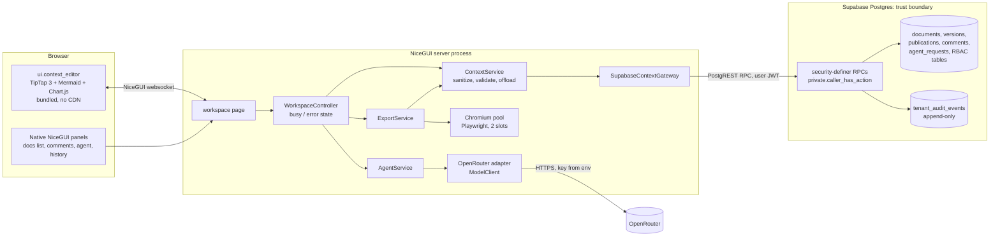
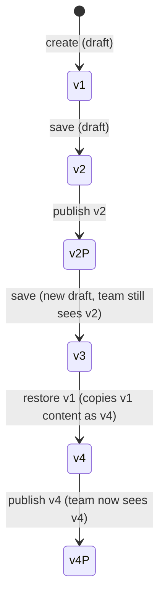
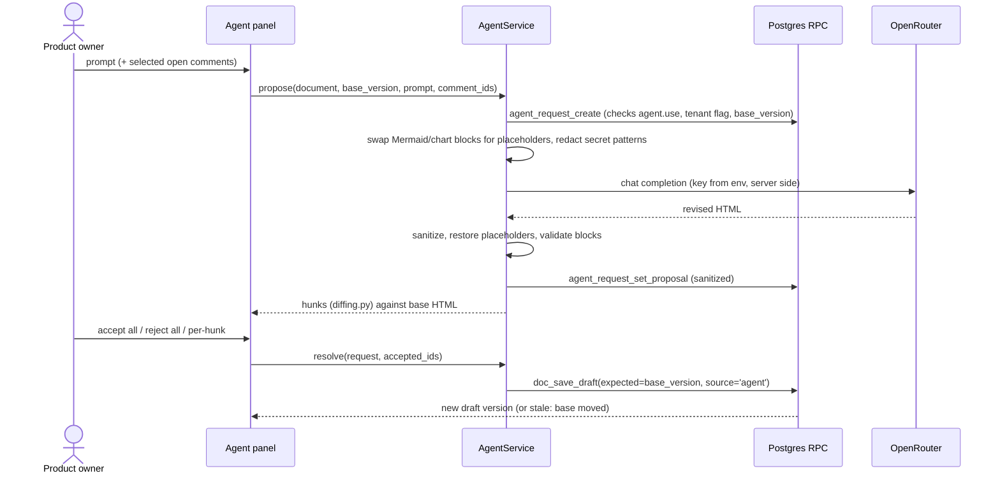
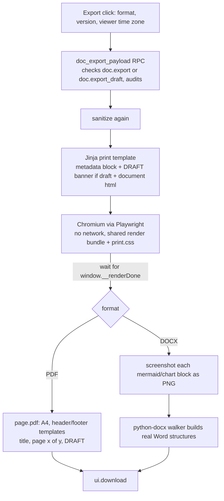

---
tags:
  - sdlc
  - architecture
  - design
status: draft, awaiting approval
created: 2026-10-22
---

# Project Context Editor: Design

> **Status: approved and built (2026-10-22).** The decisions below replace the recommendations in section 1; the rest of
> this document is the original design and is still accurate except where this block says otherwise.
>
> | # | Decision |
> | --- | --- |
> | D1 | Standalone project in this directory, integrated with `neio_sdlc_v2` later. SQLite, ERD-shaped. |
> | D2 | Editor only. No RBAC foundation migration; a small ERD-shaped role-action layer (`authz.py`) keeps permission checks honest. |
> | D3 | Sanitized HTML in the database with a content hash on every version. |
> | D4 | Comment anchors are text-quote selectors stored on the comment and drawn as decorations. |
> | D5 | Immutable versions plus an insert-only `document_publications` table; status is derived. |
> | D6 | Fonts self-hosted. |
> | D7 | Third-party data handling deferred; no per-tenant agent flag. The key is read only from the environment. |
> | D8 | The built bundle is committed. |
> | D9 | Action codes in ERD style (`doc.edit`). |
> | D10 | No default documents; one demo document is seeded. |
> | D11 | A4, Cambria/Calibri in Word. |
>
> **As built, differences from the original text:** the team sees only the latest published version (the history panel
> shows one entry for them); replies follow their thread's visibility, so an owner's reply written on the draft is visible
> to the team; saving does not require the dirty flag (it trails typing by a moment); the stale-save banner keeps the
> user's text. Added after review: file upload (`importer.py`, section above is silent on it) and unsaved edits kept while
> the owner views another version. See the README for how to run, test and integrate.

No code has been written. This document is for approval. Section 1 lists the decisions I need from you; everything after it assumes my recommended answer to each.

## 0. What I found in the repositories

| Finding | Source | Consequence for this design |
| --- | --- | --- |
| `RichMarkdownEditor_SDLCV2` is empty. The platform is `SDLCV2/neio_sdlc_v2` (package `agentic_sdlc`, Supabase Postgres, NiceGUI 3.18, Python 3.13, uv). | filesystem | The feature is designed as a new set of modules inside `neio_sdlc_v2`. |
| The role-action matrix is in the ERD only. The migrations have `tenants`, `tenant_users` (interim `tenant_admin` / `tenant_user` role), `platform_admins`, `tenant_audit_events` and tenant settings tables. There is no `projects`, `memberships`, `roles`, `actions`, `role_actions` or `membership_roles` table. | `docs/architecture/erd.md`, `supabase/migrations/` | "Reuse the RBAC structure" means building the ERD's tables first (Phase 0). I will not invent a second scheme. |
| Tenant users cannot sign in yet. F-02 (SSO sign-in) is "Not started". The only sign-in page is email+password and Azure AD for platform admins. | `docs/features/ledger.md`, `web/pages/auth.py` | The editor is reachable for seeded password users in dev. Production tenant sign-in is an F-02 dependency. |
| The ERD already defines `artifacts` and `artifact_versions` (insert-only, body in Azure Blob, hash required). Blob settings are F-07, still at "Spec drafting". | `erd.md`, ledger | The brief's `documents` / `document_versions` tables overlap the ERD. Needs an ERD amendment and your approval (D3). |
| All writes are security-definer Postgres functions that derive the tenant from `auth.uid()`, check authorization, and write the change and an append-only `tenant_audit_events` row in one transaction. Python is gateway (`_rpc`) → service (validation, `asyncio.to_thread`, typed errors) → controller (busy/error state) → page. Stale saves use SQLSTATE `55000`. | `admin/*.py`, migrations | I follow this exactly. |
| `AGENTS.md` rules: no blocking work on the event loop, busy state for every operation, icon buttons for grouped actions with `aria-label` and tooltip, a go-back button built in the shared page frame, no secrets or tenant data in logs/prompts/audit, backward-compatible migrations with tested rollback. | `AGENTS.md` | Applied throughout. |
| A prior PoC (`RME_NiceGUI`) already solved optimistic locking, one-level threaded comments, orphan handling, an authz service shaped like the ERD, and a seed script. It uses Milkdown and SQLite. | `RME_NiceGUI/docs/design.md` | I reuse its behavior rules and tests as a reference, not its code. |
| `.gitignore` ignores `dist/` and `build/`. | `.gitignore` | The editor bundle output folder would be ignored (D8). |
| The existing model layer has a `ModelClient` protocol and a LiteLLM adapter. LiteLLM is deliberately not a base dependency. | `contracts.py`, `adapters/litellm.py` | The OpenRouter client is a thin adapter implementing `ModelClient` (section 10). |

Library versions checked on npm today (all MIT): `@tiptap/*` 3.32.0, `mermaid` 12.2.0, `chart.js` 4.5.1, `lowlight` 3.3.0, `rollup` 4.65.0. They are pinned exactly, with a lockfile, when the bundle is created. Python additions (versions pinned at install): `nh3`, `lxml`, `python-docx`, `playwright`, `pygments`; dev only: `pypdf`.

## 1. Decisions needed before code

| # | Question | My recommendation | If you disagree |
| --- | --- | --- | --- |
| D1 | Where does this live? | A new feature in `neio_sdlc_v2` (next free ledger id; F-08 looks unused but the ledger mentions a superseded F-08, so confirm), following its spec → stories → LLD → plan gates. This document seeds the LLD. | Standalone repo like the PoC, with ERD-shaped tables. |
| D2 | RBAC foundation does not exist. | Phase 0 builds the ERD tables (`user_profiles`, `memberships`, `roles`, `actions`, `role_actions`, `membership_roles`, `projects`) with the minimum needed for projects and the document actions. `tenant_users` stays as is; a seeded demo maps users into memberships. | Interim: derive roles from a project-member table. This creates the parallel scheme you want to avoid, so I advise against it. |
| D3 | Document storage. ERD says `artifacts` + Blob. Brief says `documents` + `content_html` in the database. | Store sanitized HTML in Postgres now, with a `content_hash` on every version, as brief section 13 says. Propose an ERD amendment: `documents` is the editor's logical document; it gets a nullable `artifact_id` so a later Blob-backed artifact can adopt it. | Wait for F-07 and store bodies in Blob first. Adds a dependency and delays everything. |
| D4 | Comment anchors. The brief says a custom TipTap mark. A mark is part of the HTML. Team members cannot edit, and a published version must not change when someone comments. | Anchors are stored in the `comments` row as a text-quote selector (quote, prefix, suffix, offset hint). The editor draws the highlight as a ProseMirror decoration, so the document is never touched. It is still a custom TipTap extension, and still no paid comments extension. | Store a mark in the HTML. Every comment would force a new version written by someone with no edit right. Not workable. |
| D5 | Version and publish model. Brief: `document_versions.status`. ERD: versions are insert-only. | Versions are immutable. Publishing inserts a row in a new insert-only `document_publications` table (with the change note) and moves `documents.published_version`. "Status" is derived, not stored on the version. Team members see the published version number, so their numbers can skip (for example v2 then v5). | A mutable `status` column on versions. Breaks the insert-only rule. |
| D6 | Fonts. The brief says Google Fonts, and also says no CDN at runtime and offline export. | Self-host Inter, Source Serif 4 and JetBrains Mono (all SIL OFL) as woff2 in app static files. Same look, no third-party request, and the PDF renderer needs them locally anyway. | Load from Google at runtime. Fails on locked-down tenant networks and in the offline export browser. |
| D7 | Document text and comments go to OpenRouter, a third party. ERD rule 8 requires redaction and classification of tenant free text before it enters a prompt. | The agent is off until a tenant admin enables it per tenant (a flag, checked in the database). Redaction of secrets patterns (reuse `audit/redaction.py`) before sending. Prompts and responses are never logged, and audit events hold ids and hashes only. You should confirm the model and OpenRouter data-retention setting (zero-data-retention providers only). | Always on. Not defensible for a tier 3 feature. |
| D8 | The bundle output `dist/` is git-ignored. | Commit the built bundle (add a `.gitignore` exception) so `uv run` works without Node, and add a CI step that rebuilds and fails if the committed bundle differs. NiceGUI ships `codemirror/dist` the same way. | Build in Docker/CI only. Tests then need Node. |
| D9 | Action codes. Brief uses `DOC.create`. ERD examples use lowercase dotted codes (`project.create`, `audit.read`). | Use the ERD style (`doc.create`). Names map one-to-one to the brief. | Keep upper case. |
| D10 | Which are the "default documents" for the seeded project? The brief does not list them. | Provisional catalogue: Product Requirements (PRD), Solution Architecture, Technical Specification, Test Strategy, Release Notes. Each is a row in a platform-managed `document_types` table with a starter template. Please give me the real list and any templates. | |
| D11 | Export page size and DOCX fonts. | PDF on A4 (configurable). DOCX uses Cambria (body) and Calibri (UI text) because Source Serif 4 is rarely installed on Word machines; PDF uses the real fonts. | Letter, or embedded fonts in DOCX. |

## 2. Architecture



Three enforcement layers, in order of authority:

1. **Postgres RPCs (authoritative).** Each function derives the tenant from the caller's membership, resolves the caller's actions at the document's project through the role-action matrix, and rejects otherwise. Tables are deny-by-default (RLS on, no policies, no direct grants), as the existing tables are.
2. **Python service.** Validates input, sanitizes HTML, enforces size limits, maps SQLSTATE to typed errors.
3. **UI.** Reads a `doc_capabilities(project_id)` RPC to show or hide controls. A convenience only.

**Sanitization has a gap that the existing pattern creates.** The browser holds a user JWT and PostgREST is reachable, so a user can call a save RPC directly and skip the Python sanitizer. I cannot make Postgres sanitize HTML, and the app does not hold the service-role key. So: HTML is sanitized on the way in (Python) **and again on every way out** (editor load, read-only view, diff, export, agent input). Stored hostile HTML then never reaches a browser or export unsanitized. A cheap database check also rejects obvious markup (`<script`, `javascript:`, `on…=`) as a tripwire, not as the control.

## 3. Data model

Names follow the implementation (`tenant_id`, not `organization_id`; `tenants`, not `organizations`). All tables: RLS on, no policies, no direct grants, tenant-aware integrity triggers (a child row must share its parent's tenant and project), UTC `timestamptz`.

**RBAC foundation (Phase 0, from the ERD):** `user_profiles`, `memberships`, `roles` (tenant-owned, `code` unique per tenant), `actions` (platform-managed catalogue, `allowed_scope`), `role_actions`, `membership_roles` (nullable `project_id`), `projects`. A person may hold several roles; actions are the union, filtered by scope compatibility as in the ERD.

**Action catalogue added** (all project scope):

| Code | Brief equivalent | Meaning |
| --- | --- | --- |
| `doc.read` | (implicit) | Read published versions |
| `doc.read_draft` | "Only the product owner sees drafts" | Read unpublished versions, version history of drafts |
| `doc.create` | DOC.create | Create documents |
| `doc.edit` | DOC.edit | Save draft versions |
| `doc.publish` | DOC.publish | Publish |
| `doc.restore` | "restore versions" | Restore an older version as a new draft |
| `doc.export` | DOC.export | Export published versions |
| `doc.export_draft` | PO exports drafts | Export the current draft |
| `doc.comment` | DOC.comment | Comment, reply, edit/delete own comments |
| `comment.resolve` | COMMENT.resolve | Resolve and reopen any comment |
| `agent.use` | AGENT.use | Use the editing agent |

The "product owner" is whoever's role carries `doc.read_draft` + `doc.edit` + `doc.publish`. No role name appears in code or UI logic; only the seed script names roles. Several people can hold these, and optimistic locking arbitrates between them.

**Editor tables:**

```
document_types   (code pk, label, singleton bool, template_html, sort)       -- platform-managed

documents        (id, tenant_id, project_id, doc_type -> document_types, title,
                  current_version int,            -- latest saved version; also the lock token
                  published_version int null,     -- latest published version
                  created_by, created_at, updated_by, updated_at,
                  published_by null, published_at null)
                 unique (project_id, doc_type) where the type is a singleton

document_versions (id, tenant_id, project_id, document_id, version_number,
                  content_html, content_hash sha256,
                  source  check in ('manual','agent','restore'),
                  restored_from_version null, agent_request_id null,
                  created_by, created_at)
                 unique (document_id, version_number); insert-only trigger

document_publications (id, tenant_id, project_id, document_id, version_number,
                  change_note null, published_by, published_at)
                 unique (document_id, version_number); insert-only trigger

comments         (id, tenant_id, project_id, document_id, version_number,
                  anchor_id uuid null,            -- null = General
                  quoted_text, anchor_prefix, anchor_suffix, anchor_hint int,
                  parent_comment_id null,         -- one level; trigger enforces
                  author_id, author_role_code, author_role_label,  -- snapshot at write time
                  body, status check in ('open','resolved'),
                  created_at, edited_at null, deleted_at null,
                  resolved_by null, resolved_at null)

agent_requests   (id, tenant_id, project_id, document_id, requested_by,
                  prompt, comment_ids uuid[], model, base_version,
                  result_status check in ('pending','proposed','accepted','partial','rejected','failed','stale'),
                  proposal_html null,             -- sanitized; kept so a refresh does not lose a paid response
                  accepted_hunks jsonb null, resulting_version int null,
                  error_class null, correlation_id, tokens_in, tokens_out, latency_ms, created_at)

tenant_settings flag: context_agent_enabled bool (D7)
```

Notes:

- **Deviation from brief section 13:** no `status` on `document_versions` (D5). The Draft/Published badge is derived: the latest version is "Published" when `published_version = current_version`, else "Draft".
- **Comment deletion.** "Authors delete their own comments" and "never delete silently" are both honored by soft delete: `deleted_at` set, body hidden in the UI and retained, audit event written. A deleted comment that has replies shows "deleted comment" as the thread root.
- **"Text no longer present"** is derived at view time, not stored (section 9).
- **Audit.** I reuse `tenant_audit_events` with new action codes (`doc_created`, `doc_draft_saved`, `doc_published`, `doc_restored`, `doc_exported`, `comment_added`, `comment_edited`, `comment_deleted`, `comment_resolved`, `comment_reopened`, `agent_requested`, `agent_resolved`). Payloads carry ids, version numbers and hashes. Never document text, comment bodies, or prompts (AGENTS.md).
- **ERD amendments proposed** (each needs your approval): D3 (`documents.artifact_id`), D5 (`document_publications`), `agent_requests` (document-editing detail that hangs off the ERD's future `agent_runs`), the action catalogue rows above, and `document_types`.

## 4. Server rules (what the RPCs enforce)

| RPC | Checks | Notes |
| --- | --- | --- |
| `doc_list(project)` | membership in project. Callers without `doc.read_draft` get only documents with `published_version` set. | Badges derived. |
| `doc_get(document, version?)` | No version given: draft readers get `current_version`, others get `published_version`. | A document with no published version is **not found** for non-draft readers, same text as a missing id (no existence leak). An explicit unpublished version by a non-draft reader is **access denied**. |
| `doc_versions(document)` | Draft readers: all versions. Others: only published versions. | |
| `doc_save_draft(document, expected_version, html, source, …)` | `doc.edit`. `source='agent'` also needs `agent.use`. `source='restore'` needs `doc.restore`. | One statement: `update documents set current_version = current_version + 1 … where id = ? and current_version = expected`. No row updated → SQLSTATE `55000` "Document changed, reload" (same code the settings screens use). Inserts the version, sets `updated_by/at`, writes the audit event, all in one transaction. |
| `doc_publish(document, version, change_note?)` | `doc.publish`. `version` must equal `current_version` (else stale). Rejects if already published. | Inserts publication, sets `published_version/by/at`, audits. Never creates a content version. |
| `doc_restore(document, from_version, expected_version)` | `doc.restore`. | Copies the old content into a new version with `source='restore'`. |
| `doc_export_payload(document, version?, as_draft)` | `doc.export`, or `doc.export_draft` for an unpublished version. | Returns HTML and metadata; writes the audit event. The export is built only from this result. |
| `comment_add / edit / delete / resolve / reopen` | `doc.comment` (own comments only for edit/delete); `comment.resolve` for resolve/reopen. Comments are only accepted on published versions the caller can read. | |
| `agent_*` | `agent.use`, tenant flag on, `base_version` must equal `current_version` when the result is applied. | |
| `doc_capabilities(project)` | membership | Returns the caller's action codes for the UI only. |

Metadata (title, type, version, status, created/edited/published date and user) is **generated by the service from these rows**, never stored in `content_html`, and rendered by the page (a non-editable header block) and by the export templates from the same `DocMetadata` model. Times are UTC in the database; the browser's IANA time zone is read once per session and passed to the formatter, and again to the export (validated against `zoneinfo`).

## 5. The editor element

`ui.context_editor`, in `web/context_editor/`, built the way NiceGUI builds `ui.codemirror`: a Python `Element` subclass with `component='context_editor.js'` and `esm={'context-editor': 'dist'}`, a `package.json`, `rollup.config.mjs`, `src/index.mjs`, and bundled output in `dist/` (D8). Mermaid and Chart.js are dynamic imports, so rollup emits them as separate lazy chunks and the editor opens fast.

**Python API**

| Member | Purpose |
| --- | --- |
| `value: str` (HTML) | Two-way. Debounced 500 ms client to server. |
| `readonly: bool` | Switchable at runtime. |
| `on_change`, `on_save` (Ctrl/Cmd+S) | As in the brief. |
| `on_dirty` | Cheap event on every edit with no payload, so the unsaved indicator never costs a 200 KB websocket message. The full HTML travels on the debounce, on save, or on `await editor.get_html()`. |
| `set_comment_anchors(list)`, event `anchors_resolved` | Comments (section 9). |
| `on_selection_comment`, `on_comment_click` | Comment creation and highlight clicks. |
| `show_diff(hunks)`, events `hunk_decision` | Agent and version compare (section 8). |
| `theme` | light/dark, follows `ui.dark_mode`. |

**Extensions** (all MIT, no Pro, no Cloud):

| Brief feature | Implementation |
| --- | --- |
| Bold, italic, strike, inline code, underline, link | `starter-kit` (v3 bundles underline and link) |
| Subscript, superscript | `extension-subscript`, `extension-superscript` |
| H1–H4, paragraph, blockquote, hr | `starter-kit`, headings limited to levels 1–4 |
| Bullet, numbered, checklist; indent/outdent | list extensions + `task-list`/`task-item` (nested); Tab / Shift+Tab call `sinkListItem` / `liftListItem` |
| Links: add, edit, remove, open in new tab | `link` with a small popover for edit/remove. Saved links always carry `target="_blank" rel="noopener noreferrer"` (enforced by the sanitizer). Protocols: `http`, `https`, `mailto` only. |
| Alignment, color, highlight | `text-align`, `text-style` + `color`, `highlight` (multicolor) |
| Tables: insert, rows/columns, header row, merge cells | `table`, `table-row`, `table-header`, `table-cell`; merge and split via the table commands in the free package. Column resizing is off so no `colgroup` or pixel widths are stored. |
| Code blocks with highlighting | `code-block-lowlight` with lowlight's `common` language set. Source is stored plain; highlighting is applied at render. |
| Undo/redo, clear formatting | `starter-kit` undo/redo; clear = unset marks + clear nodes |
| Shortcuts | Tiptap defaults match Word/Docs for B, I, U, K, Z, Y; `Mod-Alt-1..4` for headings; `Mod-Shift-7/8/9` for lists |
| Fixed toolbar, floating toolbar, slash menu | Toolbar in plain DOM (icon buttons with tooltips and aria-labels); `extension-bubble-menu`; `@tiptap/suggestion` driving a small menu |
| Mermaid, chart blocks | Two custom atom nodes with NodeViews (sections 6, 7) |
| Comment highlights | Custom decoration plugin (section 9) |

Custom `renderHTML` choices keep the stored HTML small and sanitizable: task items render as `<li data-type="taskItem" data-checked="true"><div>…</div></li>` (the checkbox exists only in the NodeView, so `<input>` is never in storage); colors and alignment use `style` with only `color`, `background-color`, `text-align`; blocks carry `data-` attributes.

**Sanitizer** (`context/sanitizer.py`, nh3 with an `attribute_filter`): a strict tag/attribute allowlist generated from the same list the editor schema uses, plus block validators run after sanitizing:

- `style`: only the three properties above, values matched against strict patterns (hex, `rgb()`, named alignment).
- `div[data-type=mermaid]`: code length ≤ 20,000 chars, stored as text content.
- `div[data-type=chart]`: JSON validated with a pydantic model (chart type in bar/line/pie/area, ≤ 12 series, ≤ 200 labels, numeric values only, titles ≤ 200 chars). Invalid JSON fails the save with a field error. It is never silently repaired.
- Document size cap 1 MB.

A contract test ties the two sides together: a fixture document that uses every node and mark is loaded into the real editor in headless Chromium, serialized, and compared with the output of the sanitizer. They must be identical. If the schema ever emits something the allowlist drops, this test fails.

**Layout** (`web/pages/workspace.py`): `/projects/{project_id}/documents/{document_id}`. Left: documents of the project with status badges. Centre: non-editable metadata block, then the editor on a ~760 px canvas. Right: toggleable comments or agent panel. A new `workspace_frame` wraps the existing `page_frame` conventions so the go-back button still comes from shared layout code. Premium styling comes from one CSS file with design tokens (neutral palette, one accent, light and dark), Quasar overrides kept in that file, skeleton loaders while the first RPC returns, and `ui.notify` toasts. Tablet width collapses the sidebars into drawers.

## 6. Mermaid blocks

- **Storage:** `<div data-type="mermaid">` with the diagram source as text content. The rendered SVG is never stored.
- **In the editor:** the NodeView renders the SVG live, using Mermaid pinned and bundled, `securityLevel: 'strict'`, theme following light/dark.
- **Click to edit:** opens a split dialog, code on the left (a small plain `<textarea>` with monospace, no second code editor to bundle) and live preview on the right, 300 ms debounce. Parse errors from `mermaid.parse()` show inline under the code; the last good preview stays visible. Saving a block with invalid code is allowed (it renders as an error card), because blocking save would trap the user.
- **Read-only view and exports** use the same render function (section 11), so all three look the same. Exports always render with the light theme.

## 7. Chart blocks

- **Storage:** `<div data-type="chart" data-chart='{"type":"bar","title":"…","labels":[…],"series":[{"name":"…","values":[…]}]}'>`. Plain JSON, validated server side.
- **In the editor:** a Chart.js canvas in the NodeView. Chart.js animation is disabled so screenshots and prints are deterministic.
- **Editing:** a dialog with a type selector, a title, and a small table (rows = labels, columns = series, add/remove row and column). Pie uses one series.
- **Palette:** a fixed, accessible categorical palette defined once in the bundle and reused by the print CSS.

## 8. Versioning, publish, compare



- **Save** is explicit (Save button, Ctrl/Cmd+S). Every save is one version. There is no auto-save that would flood history; an unsaved-changes dot shows when the editor differs from the last save.
- **Stale save:** a second tab or an accepted agent change moves `current_version`; a save from the old tab returns "Document changed, reload". The user's text stays in the editor and a banner offers Reload and Copy my version.
- **Publish dialog:** shows the version, an optional change note, and a confirm. After publishing the team sees the latest published version; the owner's later drafts are invisible to them (enforced by `doc_get`, section 4).
- **A "published view" toggle** lets the owner see exactly what the team sees.
- **A new-version banner** (a 60 s `ui.timer` check of `published_version`) tells team members to reload when something was published. Not real-time co-editing.
- **History panel:** versions the viewer may see, with author, time, source badge (manual, agent, restore) and a published badge. View any version read-only; restore creates a new draft version.
- **Compare two versions and the agent diff share one engine**, `context/diffing.py`:
  1. Parse sanitized HTML into top-level blocks (lxml) and fingerprint each.
  2. Align the two block lists with `difflib.SequenceMatcher`.
  3. Each non-equal region is a **hunk** (`added`, `removed`, `modified`) with stable ids. For `modified` text blocks the engine also produces inline word-level `<ins>`/`<del>` markup. Tables, lists, diagrams and charts are compared as whole blocks, with text diff inside lists and table cells where cheap.
  4. `apply_hunks(base_html, hunks, accepted_ids)` rebuilds the HTML from the base plus the accepted hunks.
  The diff lives in Python so it is unit-testable without a browser. The editor only draws hunks (green additions, red strikethrough removals) and reports accept/reject decisions. Limitation to confirm: "individual changes" means a block-level hunk, not a single word inside a paragraph. I think this is what a product owner wants to review, and it is far more reliable than character-level partial accepts. Phase 4 starts with a one-to-two-day spike to confirm the result reads well on real documents; fallback is a ProseMirror-level diff.

## 9. Comments and annotations

- **Creating:** the user selects text in a published version, the bubble menu shows a comment icon, and the editor sends `{quote, prefix, suffix, hint}` (the 32 characters either side and the offset in the document's text projection) to the server. The native comment composer opens in the right panel. Selections inside Mermaid or chart blocks cannot be annotated. Cross-paragraph selections are allowed.
- **Anchoring:** exactly the W3C text-quote selector idea: find the quote near `hint`, prefer the occurrence whose prefix and suffix match, fall back to the quote alone, else "not found". Highlights are decorations. Clicking one emits `comment_click(anchor_id)` and the panel scrolls to and opens the thread.
- **Single source of truth.** The JavaScript resolver decides what is found; it reports `anchors_resolved: {id: bool}` and the panel labels the rest "text no longer present". There is no second Python implementation to drift apart. The resolver is unit-tested with a shared JSON fixture file (vitest).
- **Across versions:** a comment keeps the `version_number` it was made on and is shown with that version tag. Viewing a newer published version re-anchors it with the same selector. The owner's draft re-anchors them too, which is how the owner sees what to incorporate. A comment whose text is gone is kept, listed, and marked; nothing is deleted.
- **Panel** (native NiceGUI): filter all/open/resolved; General comments tab; each item shows author, role badge (from the snapshot, e.g. QA, Architect), created time, "edited" time, status, and the version it was made on. One reply level. Authors edit and delete their own; holders of `comment.resolve` resolve and reopen any thread.

## 10. AI editing agent



- **Provider:** a thin `OpenRouterModelClient` in `adapters/openrouter.py` implementing the existing `ModelClient` protocol over `httpx` against the OpenAI-compatible endpoint. No new heavy dependency. The model comes from `OPENROUTER_MODEL`, the key from `OPENROUTER_API_KEY` only. The key is held as a `SecretStr`-style value with a redacted repr, never put in a prompt, log line, audit event, exception message or any value sent to the browser. A redaction rule for the `sk-or-` prefix is added to the log pipeline as a second line of defense. `.env.example` gets placeholders for both variables (and the agent flag documentation).
- **Prompt design:** system prompt fixes the role ("edit this HTML document; return only the full revised HTML; use only these tags; Mermaid blocks must be valid"). The document, the instruction and any selected comments (body and quoted text) go in clearly delimited data sections with the instruction that the content is data, never instructions. This follows the repo rule that text from tickets and comments is data.
- **Preserving diagrams and charts:** before sending, each Mermaid and chart block is replaced with `<div data-preserve="b3"></div>`. The model returns the placeholders in place; the server swaps the originals back. To change a diagram the model emits a new block instead of a placeholder. A dropped placeholder shows up as a removal hunk the owner can reject. This also cuts tokens.
- **The agent cannot publish.** `AgentService` has no reference to the publish gateway method; `doc_save_draft` with `source='agent'` is the only write it can cause, and the owner's accept click is what triggers it.
- **Output handling:** sanitized, then validated like any save. Mermaid blocks in the proposal are parsed in the browser when the diff renders; a hunk with invalid Mermaid shows an error badge and its Accept is disabled until the owner rejects or edits it.
- **Failure handling:** timeouts (60 s), 429 and 5xx with bounded exponential backoff (3 tries), empty or non-HTML output, oversize document, provider down. Each maps to one friendly message and an `agent_requests` row with `result_status='failed'` and `error_class`. The document is never written on failure. A Cancel button aborts the in-flight call.
- **Cost and abuse controls:** one in-flight request per document and a per-user rate limit (default 10 per minute), configurable. Token counts are stored.
- **Stale base:** accept is refused if `current_version != base_version`. The panel offers to re-run the same prompt on the new version.

## 11. Export pipeline



- **One renderer.** The editor NodeViews, the read-only view and the export page all call the same `renderBlocks(root)` function from the bundle (a second small entry point, `render-static.mjs`, used by export). That is how "diagrams and charts look identical" is enforced rather than hoped for. The same `document.css` styles the editor canvas and the print page; only a `@media print` layer differs.
- **Headless Chromium:** launched lazily, kept warm, restarted if it dies, at most 2 concurrent pages, 30 s hard timeout per export. Requests to anything other than the local page are aborted. JavaScript comes only from our bundle (injected), never from the document, which is sanitized and cannot contain script. Runs with Playwright's async API, so it never blocks the event loop; the export button shows a spinner and is disabled for the duration (AGENTS.md).
- **PDF:** `page.pdf` with `display_header_footer`, header = document title, footer = page number / total, plus "DRAFT" in the header for drafts. Print CSS handles `break-inside: avoid` for tables rows, figures, and headings.
- **DOCX:** a python-docx walker over the sanitized HTML (lxml) producing real structures: Heading 1–4 styles, real bulleted and numbered lists (numbering definitions, with nested levels), real tables (colspan/rowspan become merged cells, header row repeats), hyperlinks (relationship-backed), runs for bold/italic/underline/strike/sub/sup/code, text color and highlight, paragraph alignment, block quotes, horizontal rule as a paragraph border, checklists as ☐ / ☑ paragraphs, code blocks in a monospace shaded style with Pygments-colored runs (colors approximate the on-screen theme), Mermaid and charts as PNG pictures with the source in the alt text, a metadata table at the top, header with title and footer with a PAGE field, and "DRAFT" header text for drafts. Built on a bundled reference template so styles are consistent.
- **Why not pandoc or an HTML-to-DOCX package:** they drop color, highlight and alignment, and give little control over tables and lists. Pandoc is the fallback if the walker proves too costly; a one-week spike at the start of Phase 6 settles it.
- **Draft rule:** team members never reach the draft path (the RPC refuses). The owner's draft export is marked DRAFT in the metadata block, the PDF header, and the DOCX header, and the file name carries `-DRAFT`.
- **Deployment impact:** the container image needs Chromium and its system libraries (`playwright install --with-deps chromium`), roughly 400 MB. This goes into the deploy checklist.

## 12. Security summary

| Threat | Control |
| --- | --- |
| Non-owner reads a draft | RPC filters by action; draft readers only; not-found vs denied rules; pgTAP and gateway tests for every read RPC |
| Non-owner writes or publishes | RPC checks the action; UI is only a convenience |
| Cross-tenant or unassigned-project access | tenant derived from caller, project from `membership_roles`; same "not found" for foreign ids |
| Stored XSS (editor, agent, direct RPC) | sanitize in and out, allowlist, style filter, JSON validation, nh3, CSP header on the page |
| Malicious diagram or chart content | Mermaid `strict`, source stored as text, chart JSON schema-validated |
| Prompt injection via document or comments | content passed as delimited data, output sanitized, agent has no tool or publish capability, owner approves every change |
| API key leakage | env only, redacted repr, never in prompts, logs, audit, browser; log redaction rule; tests grep responses and logs |
| Tenant data sent to a third party | per-tenant flag (D7), secret-pattern redaction, no prompt logging, zero-retention provider setting |
| Export browser abuse (SSRF, script) | no network, no document script, sanitized input, time and concurrency limits |
| Comment spoofing | role snapshot written by the RPC from the caller's assignment, never from the client |
| Lost updates | optimistic lock on `current_version` |

## 13. File list

New or changed, all under `neio_sdlc_v2`:

```
supabase/migrations/
  2026102x…_rbac_foundation.sql          user_profiles, memberships, roles, actions, role_actions,
                                         membership_roles, projects; private.caller_has_action()
  2026102x…_context_documents.sql        document_types, documents, document_versions,
                                         document_publications, triggers, RLS deny
  2026102x…_context_document_rpcs.sql    list/get/versions/save/publish/restore/export_payload/capabilities
  2026102x…_context_comments.sql         comments + RPCs
  2026102x…_context_agent.sql            agent_requests, tenant flag, RPCs
supabase/rollback/…_down.sql             one per migration
supabase/tests/                          pgTAP per migration (allowed and denied paths)

src/agentic_sdlc/context/
  models.py        records, DocMetadata, typed errors (StaleDocument, DraftNotAvailable, …)
  sanitizer.py     nh3 allowlist, style filter, block validators
  gateway.py       SupabaseContextGateway
  service.py       ContextService (documents, versions, publish)
  comment_service.py
  diffing.py       block diff, hunks, apply_hunks
  metadata.py      metadata block and time-zone formatting
  agent/           service.py, prompt.py, protect.py (placeholders), settings.py (env)
  export/          service.py, browser.py (Chromium pool), pdf.py, docx.py,
                   templates/print.html, print.css, reference.docx
src/agentic_sdlc/adapters/openrouter.py  ModelClient over httpx
src/agentic_sdlc/web/context_editor/
  context_editor.py  context_editor.js  package.json  package-lock.json  rollup.config.mjs
  src/index.mjs  src/render-static.mjs  src/schema.mjs
  src/extensions/ mermaid.mjs  chart.mjs  slash.mjs  comment-decorations.mjs  diff-view.mjs
  src/ui/ toolbar.mjs  bubble.mjs  link-popover.mjs  dialogs (mermaid split view, chart table)
  dist/            (committed, D8)
src/agentic_sdlc/web/
  pages/workspace.py  workspace_controller.py  workspace_frame.py (in layout.py)
  components/ doc_sidebar.py  comments_panel.py  agent_panel.py  history_panel.py
              publish_dialog.py  diff_panel.py  metadata_block.py
  routes/export.py   (the download route also re-checks session and action)
  static/ fonts/*.woff2  context.css
scripts/build_editor.sh   seed_demo_context.py (refuses a non-local Supabase URL)
tests/                    test_ctx_*.py (see section 14)
.env.example              OPENROUTER_API_KEY, OPENROUTER_MODEL (placeholders)
pyproject.toml            nh3, lxml, python-docx, playwright, pygments; dev: pypdf
.gitignore                exception for the editor dist
docs/features/…           spec, story baseline, LLD, plan, ledger row (per repo process, after D1)
```

## 14. Testing and acceptance mapping

| Brief section 15 criterion | How it is proved |
| --- | --- |
| Every formatting feature survives save → reload → export | Browser tests (Playwright, `@pytest.mark.browser`) apply each feature via toolbar and shortcut, save, reload, compare. The round-trip contract test (editor ↔ sanitizer). Export tests assert structure per feature (below). |
| Mermaid renders, live preview, invalid syntax shows error | Browser tests; vitest for the render function |
| Charts render in editor and both exports | Browser test; PDF checked with `pypdf` text and a rendered-image check for the chart region; DOCX contains the picture |
| DOCX has real headings and tables; PDF matches screen | python-docx inspection (style names, table cell merges, list numbering, hyperlink relationships); a golden PDF text and page-count test; visual diff of one reference page against a stored image with tolerance |
| Metadata correct, updates on every save, version increments | Service and pgTAP tests |
| Non-owners never get draft content from any endpoint | pgTAP and gateway tests that call every read RPC and the export route as each role and as a stranger, asserting no draft bytes in any response |
| Publish visible to team, later drafts hidden | pgTAP + service scenario test (publish v2, save v3, team reads v2 only) |
| Role tests: non-owner edit/publish rejected, comment permissions, cross-tenant denied | pgTAP matrix: every RPC × (owner, each other role, unassigned user, other tenant) |
| Agent: diff appears, accept makes a draft, reject changes nothing, key never leaks | Fake `ModelClient` for determinism; assertions on versions; a test that scans responses, logs, and audit rows for the key value; one opt-in live test behind an env flag |
| Stale save rejected | RPC test and a two-tab browser test |
| Seeded demo | `seed_demo_context.py` creates a demo tenant, project, one password user per role, a user in another tenant, an unassigned user, all default documents, one document with published v3 and draft v4, and sample comments in each state. An integration test runs the seed and walks the main flow. |

Also: sanitizer property tests (a corpus of known XSS payloads, idempotence: sanitize(sanitize(x)) == sanitize(x)), diff engine unit tests, accessibility checks on the toolbar (focus order, aria labels), and the existing rollback-script test pattern for every migration.

## 15. Phased build order

Each phase ends green (pytest, pgTAP, vitest, browser tests) and is reviewable on its own. Sizes: S ≈ days, M ≈ 1–2 weeks, L ≈ 2–3 weeks, for one engineer.

| Phase | Scope | Size | Exit criteria |
| --- | --- | --- | --- |
| 0 | Close D1–D11. Spec, story baseline, LLD in the repo format. ERD/HLD amendment request. | S | Your approval of each amendment |
| 1 | **RBAC foundation:** migrations, `caller_has_action`, action catalogue, seed roles in the demo, role-matrix pgTAP tests | M | Tests prove scope rules and cross-tenant denial |
| 2 | **Document core without the rich editor:** document tables, RPCs, sanitizer, service/gateway, versions, optimistic locking, publish rules, audit events, metadata model. A plain read-only page proves the flow. | M | Draft-invisibility, stale-save and role tests green at RPC level |
| 3 | **Editor element:** bundle pipeline, `ui.context_editor`, all section 4 formatting, toolbars, slash menu, self-hosted fonts, light/dark, workspace layout, save/unsaved indicator, read-only switch, round-trip contract test | L | Formatting survives save → reload; contract test green |
| 4 | **Mermaid and chart blocks** with split view and chart dialog; the shared render function | M | Live preview, error display, identical rendering in read-only |
| 5 | **Publish, history, compare, restore:** publish dialog, history panel, `diffing.py` (after the spike), diff view | M | Compare and restore work; diff unit tests green |
| 6 | **Comments:** decoration anchors, resolver, panel, filters, replies, orphan marking | M | Anchors survive edits; orphan case covered |
| 7 | **Export:** Chromium pool, PDF, then DOCX walker (after the pandoc-vs-walker spike), draft marking, audit | L | Export criteria in section 14 |
| 8 | **AI agent:** OpenRouter adapter, prompt and placeholder protection, proposal, diff accept/reject, error paths, tenant flag, rate limit | M | Agent criteria in section 14, key-leak test green |
| 9 | **Seed and hardening:** `seed_demo_context.py`, accessibility and responsive pass, performance check on a large document, security review (the repo's tester, senior developer and security tester cycle), deploy checklist (Chromium, env vars, bundle rebuild check) | M | Demo walkthrough; review cycle closed |

Order rationale: security and data come before UI so every later screen is built on enforced rules; blocks come before export because export must render them; comments and diff come before the agent because the agent consumes both.

## 16. Risks I want you to know about

- **RBAC scope.** Phase 1 is more work than the editor's brief suggests, because the foundation tables do not exist (D2). It is also the right place to spend that effort once.
- **Tenant sign-in.** Until F-02 ships, only seeded password users can open the editor. If F-02 slips, so does real use.
- **Block-level diff** may feel coarse on long paragraphs; the spike in Phase 5 is there to find out early.
- **DOCX fidelity** is the least predictable part; I will show a sample file early in Phase 7.
- **Chromium in production** adds image size and one more process to supervise.
- **Mermaid bundle size** (multi-megabyte, lazy-loaded) affects first diagram render, not first page load.
- **Data to OpenRouter** is a policy question beyond code (D7).

## 17. Out of scope (unchanged from the brief)

Real-time co-editing, images, agent-raised flags, delivery timeline documents.
